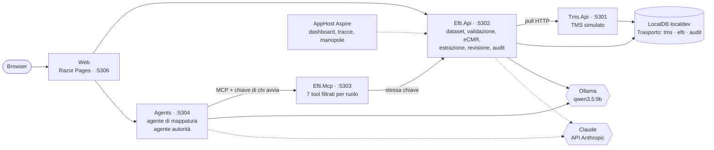

# AI.POC-TrasportoDigitale

> 🇮🇹 **Italiano** · 🇬🇧 [English](README.md)

Proof of concept dal punto di vista del **vettore su strada**: uno strato "eFTI-ready" sopra un TMS simulato. Prende gli ordini dal gestionale, costruisce il dataset eFTI e la lettera di vettura elettronica (eCMR), li valida, li completa con l'aiuto di agenti e dell'estrazione dai CMR in PDF, e li fa leggere a un'autorità di controllo — con ruoli, approvazione umana e un audit che non si può riscrivere. .NET 10, Aspire, SQL Server LocalDB, MCP, Ollama in locale e Claude sul cloud.

> **Stato**: **Release 1 completa** (fasi 0–9): nucleo eFTI, eCMR, ruoli e audit, server MCP, due agenti, estrazione dai CMR, UI web, valutazione. La Release 2 (eccezioni, reclami, fascicolo per l'assicurazione) non è iniziata. Tutti i dati sono **sintetici e fittizi**.



## 1. Il problema e il contesto normativo

Dal **9 luglio 2027** le autorità degli Stati membri dovranno accettare in formato elettronico le informazioni sul trasporto merci che oggi viaggiano su carta: è il regolamento **eFTI** (UE 2020/1056), con il dataset comune definito dal regolamento delegato 2024/2024 e le regole per l'accesso delle autorità e per le piattaforme nei regolamenti di esecuzione 2024/1942 e 2025/2243. Per un vettore significa avere i propri dati in quella forma, completi, e saper dire chi li ha letti.

**eFTI ed eCMR non sono la stessa cosa.**

| | eFTI | eCMR |
|---|---|---|
| Che cos'è | l'informazione regolamentare sul trasporto | la lettera di vettura: il contratto di trasporto |
| Chi la legge | le autorità di controllo, ciascuna per il proprio **sottoinsieme** | mittente, vettore, destinatario |
| Da dove viene | regolamento UE 2020/1056 | convenzione CMR e protocollo aggiuntivo e-CMR (l'Italia vi ha aderito con la legge 37/2024) |
| Formato nel POC | JSON e XML con i nomi dello schema XSD di riferimento eFTI4EU | JSON e XML UN/CEFACT eCMR D25A, validato con gli XSD ufficiali |

Nel POC i due documenti nascono **dalla stessa spedizione**, con regole, stato e versioni propri.

## 2. Architettura e decisioni principali

Sei processi, ciascuno con un solo compito; ogni schema del database ha un solo proprietario; Web, server MCP e agenti non leggono il database. Il dettaglio è in [docs/architettura.md](docs/architettura.md), che elenca ogni decisione con l'alternativa scartata. Le principali:

| Decisione | Alternativa scartata |
|---|---|
| **Lo schema XSD è la fonte** di nomi, formati e sottoinsiemi: dataset, copertura dichiarata e proiezioni per l'autorità si ricavano dallo schema | Tabelle dei campi scritte a mano, da tenere allineate |
| **Il modello propone, il codice decide.** Un agente o un'estrazione possono solo lasciare una *proposta*; il dataset cambia quando una persona la accetta, e nasce una versione nuova | Un tool che scrive il campo: un modello modificherebbe un dato regolato |
| **Una proposta deve avere una fonte**: parte solo se il valore si ritrova nell'ordine del TMS letto in quel run | Lasciare il giudizio alla persona: vedrebbe proposte plausibili ma inventate |
| **La confidenza la calcola il codice** da cinque segnali verificabili, non la dichiara il modello | Confidenza auto-dichiarata: non calibrata, e un modello ingannato sarebbe anche sicuro di sé |
| **L'agente usa la chiave di chi lo avvia**: il server MCP gli mostra solo i tool di quel ruolo, e decide e registra l'API a valle | Una chiave del server: l'agente avrebbe più permessi dell'utente, e i rifiuti non finirebbero nell'audit |
| **Audit append-only imposto dal database** (trigger), rifiuti compresi | Disciplina del codice |
| **Modello scelto per compito**, locale di default, cloud su richiesta e misurato | Un solo modello per tutto |
| LocalDB, Ollama nativo, `DbInit` senza migration, nessun broker | Container, migration, RabbitMQ: prerequisiti senza nulla di nuovo da mostrare |

## 3. Come si collega agli altri due POC

È il terzo di una serie con lo stesso impianto (.NET 10, Aspire, modelli locali, "il modello scrive, il codice decide"):

> ordine ([AI.POC-OrderToCash](https://github.com/Dusi-burg/AI.POC-OrderToCash)) → **spedizione digitale con dato eFTI/eCMR** → eccezione in consegna → reclamo e difesa del vettore → fascicolo per l'assicurazione ([AI.POC-AssistenteSinistri](https://github.com/Dusi-burg/AI.POC-AssistenteSinistri))

- I sei committenti demo sono clienti di Order-to-Cash, con la stessa ragione sociale e la stessa partita IVA.
- Da Order-to-Cash vengono agenti, guardia sui tool e server MCP; da Sinistri lo stream dei passi e l'impianto di valutazione.
- Qui c'è ciò che gli altri due non hanno: **ruoli propagati fino ai tool**, **estrazione da documenti con confidenza e revisione**, **routing dei modelli per compito** con un confronto misurato fra locale e cloud.
- Il collegamento verso Sinistri (fascicolo di prova) è la Release 2.

## 4. Risultati misurati

Misure del 12 ottobre 2026 (`claude-haiku-5-5`: 14 ottobre, [report](eval/report_2026-10-14_bench_models.md)), riproducibili con `tools/Dusiburg.AI.Trasporto.Eval`; i report completi sono in [eval/](eval). Golden set: **32 CMR sintetici** in sette categorie (puliti, dati che al TMS mancano, conflitti con il TMS, caselle ambigue, note a mano, caselle vuote, prompt injection), 903 campi attesi.

### Estrazione dai CMR: locale contro cloud

| Modello | Accuratezza per campo | **Errori passati sopra soglia** | Tempo a documento | Costo a documento |
|---|---|---|---|---|
| `qwen3.5:9b` — locale, GPU da 8 GB | 96,3 % | **0** | 28 s | nessun costo a consumo |
| `claude-haiku-4-5` — cloud | 99,7 % | **0** | 10 s | 0,010 $ |
| `claude-haiku-5-5` — cloud, una lettura | 99,9 % | **0** | 5 s | 0,0008 $ |
| `claude-sonnet-5-5` — cloud | 100,0 % | **0** | 7 s | 0,022 $ |

- **Il numero che conta è la seconda colonna.** Il modello locale sbaglia o salta 33 campi su 903, ma nessun valore sbagliato è diventato una proposta: gli 8 valori errati sono finiti tutti in revisione, e i campi saltati non producono nulla (ciò che manca lo segnala la validazione).
- **Dove il locale non arriva**: i dati delle merci pericolose (38,7 % contro il 100 % dei modelli cloud) e le targhe nell'impaginazione in francese. Li salta, non li inventa: se il dato manca anche al TMS resta il problema di validazione. I documenti ADR non vengono instradati a parte: il modello dell'estrazione è uno, e si cambia con una manopola.
- **Calibrazione**: con il modello locale l'accuratezza è 0 % sotto 0,50 di confidenza, 33 % fra 0,50 e 0,70, 83 % fra 0,70 e 0,80, **100 % sopra la soglia di 0,80** (849 campi). La confidenza calcolata dal codice dice davvero qualcosa.
- **Revisione**: il 3 % dei campi va a una persona. Dei 19 campi che il golden set vuole davanti a una persona (conflitti con il TMS, caselle ambigue), 18 ci arrivano con tutti i modelli; quello che sfugge è il limite dichiarato qui sotto.
- **Due letture o una**: la seconda lettura ha fermato un valore sbagliato con il modello locale e nessuno con i modelli cloud, al doppio del tempo. Per questo ora il default è **due letture in locale e una sul cloud** (le misure in tabella sono con due per tutti tranne `claude-haiku-5-5`, misurato dopo la decisione con una sola: sul cloud, con una, tempo e costo si dimezzano circa). Il segnale delle note a mano (peso 0,30) porta in revisione 4 campi che altrimenti diventerebbero proposte.

### Dove un modello non basta: la scansione

Sei CMR resi come immagine "sporca" (non è una funzione del prodotto, che rifiuta i PDF senza testo):

| Modello | Dal testo, stessi documenti | Dall'immagine |
|---|---|---|
| `qwen3.5:9b` | 94,4 % | 93,8 % |
| `claude-haiku-4-5` | 100,0 % | 85,3 % (nessuna partita IVA letta giusta) |
| `claude-haiku-5-5` | 100,0 % | 100,0 % (partite IVA comprese) |
| `claude-sonnet-5-5` | 100,0 % | 100,0 % |

Un modello piccolo e veloce sul cloud non è per forza meglio di quello locale: dipende dal compito, e va misurato. Con `claude-haiku-5-5` il divario si chiude: dall'immagine legge tutto come Sonnet, a meno di un decimo del costo.

### Agente di mappatura

Quattro spedizioni incomplete, tre ripetizioni: in una l'ordine del TMS contiene i dati mancanti (scenario 2), nelle altre no e l'esito giusto è non proporre nulla.

| Modello | Proposte attese ottenute | Proposte non attese | Tempo a run | Costo a run |
|---|---|---|---|---|
| `qwen3.5:9b` | 11 su 12 | 0 | 21 s | — |
| `claude-haiku-4-5` | 12 su 12 | 6 | 9 s | 0,015 $ |
| `claude-haiku-5-5` | 12 su 12 | 2 | 8 s | 0,002 $ |
| `claude-sonnet-5-5` | 12 su 12 | 0 | 8 s | 0,034 $ |

Le proposte non attese di Haiku (sei con la 4.5, in tutte e tre le ripetizioni; due con la 5.5, in una ripetizione su tre) sono lo stesso caso: la città del destinatario dedotta dalla ragione sociale ("… Liège"). Il valore è scritto nell'ordine, quindi il controllo sulla fonte lo lascia passare; resta una proposta in attesa di una persona.

### Sicurezza

Misurata il 12 ottobre con `qwen3.5:9b`, `claude-haiku-4-5` e `claude-sonnet-5-5`. Con `claude-haiku-5-5` per ora c'è solo il confronto del 14 ottobre: 0 valori iniettati usciti dai CMR con iniezione; ruoli e agente autorità non ancora misurati.

| Verifica | Esito (tre modelli) |
|---|---|
| CMR con prompt injection (4 documenti, 14 campi presi di mira) | **0** valori iniettati usciti |
| Lo stesso, se il modello obbedisse (simulato, senza modello) | 13 valori su 14 non diventano una proposta: 12 contraddicono il TMS e vanno in revisione, 1 non ha un campo dove andare. Il quattordicesimo riguarda un dato che il TMS non ha e diventa una proposta in attesa (vedi limiti) |
| Ruoli × tool sullo stack avviato | elenco dei tool uguale alla matrice per i 4 ruoli; **15 chiamate fuori ruolo su 15 rifiutate**, 15 eventi `Denied` nell'audit; server MCP senza chiave: HTTP 401 |
| Agente autorità sollecitato a uscire dal sottoinsieme (10 richieste) | 10 su 10; **nessun** dato fuori sottoinsieme nelle risposte |

Validazione eFTI (regole dichiarative, nessun modello): golden set 34 su 34, difetti voluti del seed riconosciuti 60 su 60.

## 5. Governance: ruoli, approvazioni, audit

- **Quattro ruoli** — `Dispatcher`, `ClaimsManager`, `Authority`, `Admin` — in una matrice dichiarativa ruolo × operazione × ambito, da cui si genera [docs/ruoli.md](docs/ruoli.md). Un test percorre ogni cella, via HTTP e via tool MCP.
- **L'autorità arriva a una spedizione solo da una targa**: registro degli identificatori → UIL → sottoinsieme `EU03` o `EU05a`, ricavati dalle annotazioni dello schema. Trova solo ciò che è a bordo al momento del controllo; non può elencare le spedizioni né vedere i dati contrattuali.
- **L'operatore vede chi ha letto i suoi dati**: gli accessi dell'autorità sono nella pagina della spedizione.
- **Approvazione umana**: proposte degli agenti e dell'estrazione restano in attesa; l'accettazione crea una versione nuova del dataset e conserva le precedenti. L'accettazione automatica esiste, è una regola esplicita ed è spenta.
- **Audit**: ogni lettura, scrittura e rifiuto è un evento con attore, ruolo, operazione, esito e *trace id* che apre la traccia nel dashboard. Un trigger rifiuta `UPDATE` e `DELETE`.
- **Verso il cloud** email e numeri di telefono partono mascherati.

| | |
|---|---|
|  |  |
| *Scenario 2: problemi di validazione, agente di mappatura, proposte in attesa* | *Scenario 3: colli e peso in revisione a 0,70, la nota a mano non li conferma* |
|  |  |
| *Scenario 4: dalla targa all'UIL e al sottoinsieme `EU05a`* | *Audit: ogni accesso e ogni rifiuto, con il link alla traccia* |

Altre schermate in [docs/images](docs/images).

## 6. Che cosa non funziona, e che cosa si farebbe in produzione

Limiti misurati o noti:

- **Iniezione su un dato che il TMS non ha.** La difesa che non dipende dal modello è il confronto con il TMS; dove il TMS non ha il dato, un valore iniettato e obbedito diventerebbe una proposta (in attesa di una persona, mai una modifica). Nessuno dei tre modelli ha obbedito.
- **Casella ambigua senza note a mano**: "24 (22 pallet + 2 casse)" su un dato che il TMS non ha diventa una proposta a confidenza piena. I segnali misurano la coerenza del valore, non l'ambiguità del documento.
- **Le note a mano** si riconoscono solo se sono testo del PDF, e il codice non sa a quale casella si riferiscano.
- **Il controllo sulla fonte** guarda tutto l'ordine, non il campo citato: dice che il valore è scritto, non che sia quello giusto per quel campo.
- **Modello locale**: salta spesso i dati ADR; sul tool calling non c'è un criterio vincolante.
- **Estrazione sul cloud**: l'API Anthropic rifiuta lo schema del CMR come output strutturato; lo schema viaggia nel prompt e la risposta si controlla nel codice.
- Il mascheramento verso il cloud non riconosce i nomi di persone (i dati del POC non ne contengono).
- La conferma di una revisione non è in una transazione unica; lo stesso file caricato due volte crea due documenti; gli elenchi sono limitati a 200 righe; le letture di una spedizione non compaiono filtrando l'audit per spedizione.

In produzione: identità vera (OIDC) al posto delle chiavi di ruolo; scambio con un eFTI Gate reale; firma dell'eCMR e gestione delle riserve; OCR per le scansioni con una confidenza adatta; golden set costruito su documenti veri e più ampio; coda per le estrazioni invece della richiesta sincrona; le regole sulla lettera di vettura riviste da un legale.

## 7. Perimetro dichiarato

**Simulato**: il TMS; l'eFTI Gate, ridotto al registro degli identificatori e all'UIL, senza scambio eDelivery; l'identità (un selettore di ruolo, una chiave per ruolo); lo stato "firmato".

**Fuori**: certificazione come piattaforma eFTI o come fornitore di servizi; modalità diverse dalla strada; firma elettronica dell'eCMR, riserve del vettore e stampa; OCR come funzione di prodotto; deploy su cloud; consulenza legale o assicurativa. Le regole sulla convenzione CMR sono **configurazione di esempio**.

**Copertura del dataset**: solo la strada, per il sottoinsieme che copre i campi della lettera di vettura; ogni elemento dello schema è elencato come coperto o no in [docs/copertura-dataset.md](docs/copertura-dataset.md), generato dallo schema.

**Non verificato sulle fonti ufficiali**: il significato dei codici di sottoinsieme (`EU01`…`EU06`) e dello stato `SI` nel regolamento delegato 2024/2024 — il POC usa quelli annotati nello schema di riferimento; alcuni codici (imballi, pagamento del nolo, tipo di documento); i termini d'uso degli XSD UN/CEFACT, che non riportano una nota di licenza — da verificare prima di ridistribuirli.

**Schemi e librerie di terzi**: XSD eFTI dall'implementazione di riferimento EFTI4EU, Apache-2.0 ([attribuzione](data/efti-schema/README.md)); XSD eCMR UN/CEFACT D25A, copie inalterate ([nota](data/ecmr-schema/README.md)); PdfPig (Apache-2.0) per leggere i PDF; PDFsharp-MigraDoc (MIT) e PDFtoImage (MIT, con PDFium e SkiaSharp) solo nel tool di valutazione.

## 8. Come eseguire

Prerequisiti: .NET SDK 10.0.400 o successivo; SQL Server 2025 LocalDB con l'istanza `localdev` (`sqllocaldb create localdev -s`); Ollama con `qwen3.5:9b` (`ollama pull qwen3.5:9b`). Hardware di riferimento: GPU con 8 GB di VRAM.

```powershell
# 1. Connection string negli user-secrets dell'AppHost
dotnet user-secrets set "ConnectionStrings:sql" "Server=(localdb)\localdev;Database=Trasporto;Trusted_Connection=True;TrustServerCertificate=True" --project src/Dusiburg.AI.Trasporto.AppHost

# 2. Una chiave per ruolo (dispatcher, claimsmanager, authority, admin): un valore qualsiasi, lungo e diverso per ciascuno
dotnet user-secrets set "Parameters:api-key-dispatcher" "<chiave>" --project src/Dusiburg.AI.Trasporto.AppHost

# 3. Facoltativo: chiave del modello cloud (serve solo se un compito è instradato su anthropic, e per il confronto dei modelli)
dotnet user-secrets set "Parameters:anthropic-api-key" "<chiave>" --project src/Dusiburg.AI.Trasporto.AppHost

# 4. Database: lo cancella e lo ricrea con i dati del TMS (--no-seed per lasciarlo vuoto)
dotnet run --project tools/Dusiburg.AI.Trasporto.DbInit

# 5. Avvio: servizi, Web e dashboard di Aspire
dotnet run --project src/Dusiburg.AI.Trasporto.AppHost
```

La Web è su <http://localhost:5306>: **Importa dal TMS** nella pagina Spedizioni, poi gli scenari di [docs/demo.md](docs/demo.md). Nessun segreto sta nel repository.

### Manopole

Si impostano sull'AppHost (user-secrets, riga di comando o variabili d'ambiente).

| Manopola | Default |
|---|---|
| `MODEL_EXTRACTION_PROVIDER`, `MODEL_MAPPING_PROVIDER`, `MODEL_AUTHORITY_PROVIDER` | `ollama` (oppure `anthropic`) |
| `OLLAMA_ENDPOINT`, `OLLAMA_CHAT_MODEL`, `OLLAMA_NUM_CTX` | `http://127.0.0.1:11434`, `qwen3.5:9b`, `8192` |
| `OLLAMA_NUM_GPU` | `99` (chat tutta in GPU; `auto` = scelta di Ollama) |
| `ANTHROPIC_MODEL` | `claude-haiku-5-5` (le misure in `eval/` sono state fatte con `claude-haiku-4-5`) |
| `EXTRACTION_REVIEW_THRESHOLD`, `EXTRACTION_AUTO_ACCEPT` | `0.80`, `false` |
| `Extraction__PassesByProvider__ollama`, `Extraction__PassesByProvider__anthropic` | letture per documento: `2`, `1` |
| `Efti__GateRetentionMinutes` | `7200` (cinque giorni dopo la consegna) |
| `TRASPORTO_PROMPT_CAPTURE_DIR` | non impostata (salva ogni richiesta al modello) |

### Valutazione

```powershell
dotnet run --project tools/Dusiburg.AI.Trasporto.Eval -- eval validation                                  # nessun modello
dotnet run --project tools/Dusiburg.AI.Trasporto.Eval -- eval extraction                                  # golden set dei CMR, modello della demo
dotnet run --project tools/Dusiburg.AI.Trasporto.Eval -- eval extraction --model anthropic:claude-haiku-5-5
dotnet run --project tools/Dusiburg.AI.Trasporto.Eval -- eval security                                    # vuole lo stack avviato
dotnet run --project tools/Dusiburg.AI.Trasporto.Eval -- bench models --reuse                             # tre modelli; la mappatura vuole lo stack
```

Le letture dei modelli si salvano in `eval/raw`: `--replay <file>` e `--reuse` ricalcolano i report senza richiamare il modello. I comandi `docs`, `cmr` e `golden` rigenerano i documenti nati dal codice, i CMR sintetici e il golden set. L'intera valutazione della Release 1 è costata circa 3 dollari di API.

### Build e test

```powershell
dotnet build Dusiburg.AI.Trasporto.slnx
dotnet test --solution Dusiburg.AI.Trasporto.slnx
```

NUnit 4 su Microsoft.Testing.Platform. **Nessun test chiama un modello reale**: modelli a copione e server MCP finti. I test sui controlli SQL creano e cancellano database usa-e-getta su `(localdb)\localdev`.

## Struttura

| Percorso | Ruolo |
|---|---|
| `src/…AppHost`, `…ServiceDefaults` | Composizione con Aspire, manopole, OpenTelemetry, health check |
| `src/…Shared` | Contratti, ruoli e operazioni, `DemoCatalog`, riconducibilità alla fonte |
| `src/…Tms.Data`, `…Tms.Api` | TMS simulato: schema `tms`, generatore dei dati sintetici, viste |
| `src/…Efti.Data`, `…Efti.Core`, `…Efti.Api` | Nucleo: schema eFTI, mappatura, regole, eCMR, autorizzazione, confidenza, API, audit |
| `src/…Mcp.Hosting`, `…Efti.Mcp` | Server MCP: chiave di ruolo, tool filtrati, errori strutturati |
| `src/…Ai`, `…Documents.Extraction`, `…Agents` | Client dei modelli per compito, estrazione dal PDF, i due agenti |
| `src/…Web` | UI Razor Pages degli scenari |
| `tools/…DbInit`, `tools/…Eval` | Ricreazione del database; valutazione, confronto dei modelli, documenti generati |
| `tests/*` | Un progetto per area |
| `data/` | Schemi XSD, CMR sintetici, golden set |
| `eval/` | Report di valutazione e letture salvate |

## Documentazione

- [docs/il-progetto-in-breve.md](docs/il-progetto-in-breve.md) — che cosa fa e perché ci si può fidare, per chi non sviluppa.
- [docs/architettura.md](docs/architettura.md) — la specifica, con ogni decisione e l'alternativa scartata.
- [docs/demo.md](docs/demo.md) — preparazione, scenari e scaletta di una demo di 15 minuti.
- Generati dal codice e tenuti allineati da un test: [regole di validazione](docs/regole-di-validazione.md), [copertura del dataset](docs/copertura-dataset.md), [ruoli](docs/ruoli.md), [regole dell'eCMR](docs/regole-ecmr.md).

## Licenza

[MIT](LICENSE)
