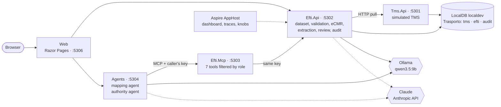
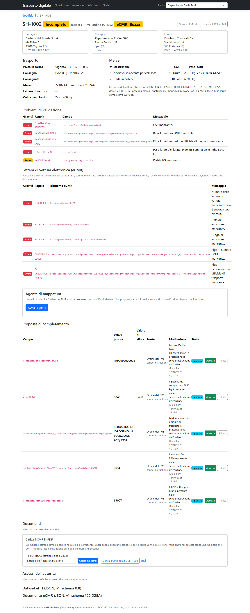
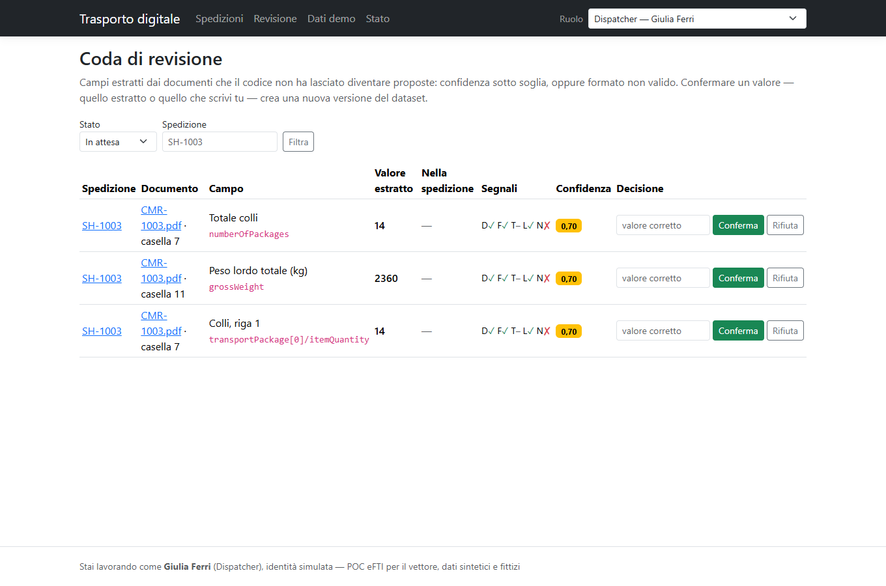
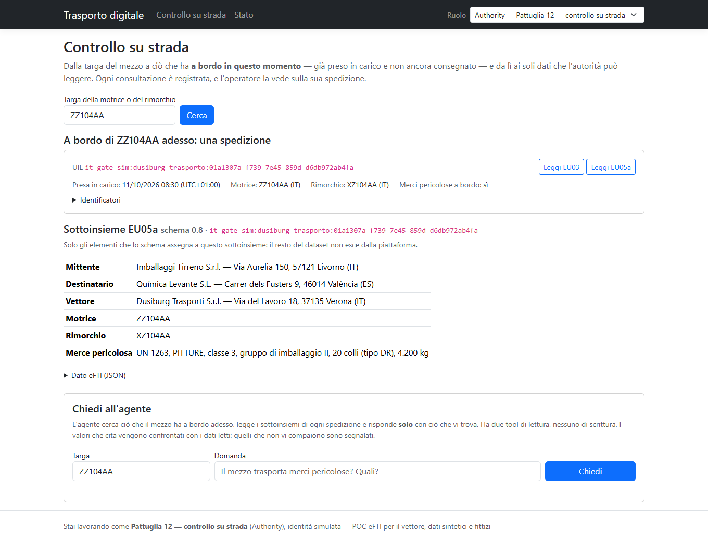
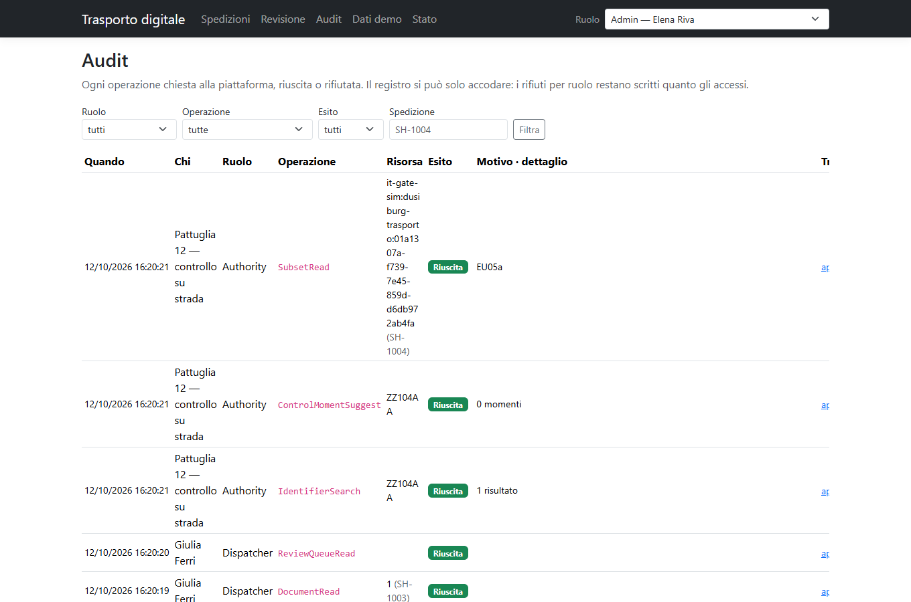

# AI.POC-TrasportoDigitale

> 🇬🇧 **English** · 🇮🇹 [Italiano](README.it.md)

Proof of concept from the point of view of a **road carrier**: an "eFTI-ready" layer on top of a simulated TMS. It takes transport orders from the TMS, builds the eFTI dataset and the electronic consignment note (eCMR), validates them, completes them with the help of agents and of extraction from CMR PDFs, and lets a control authority read them — with roles, human approval and an audit trail that cannot be rewritten. .NET 10, Aspire, SQL Server LocalDB, MCP, Ollama locally and Claude in the cloud.

> **Status**: **Release 1 complete** (phases 0–9): eFTI core, eCMR, roles and audit, MCP server, two agents, CMR extraction, web UI, evaluation. Release 2 (exceptions, claims, evidence dossier for the insurer) has not started. All data is **synthetic and fictitious**.



## 1. The problem and the regulatory context

From **9 July 2027** Member State authorities must accept in electronic form the freight transport information that travels on paper today: this is the **eFTI** regulation (EU 2020/1056), with the common dataset defined by Delegated Regulation 2024/2024 and the rules for authority access and for platforms in Implementing Regulations 2024/1942 and 2025/2243. For a carrier it means having its own data in that shape, complete, and being able to say who read it.

**eFTI and eCMR are not the same thing.**

| | eFTI | eCMR |
|---|---|---|
| What it is | the regulatory information about the transport | the consignment note: the contract of carriage |
| Who reads it | control authorities, each one its own **subset** | sender, carrier, consignee |
| Where it comes from | Regulation (EU) 2020/1056 | the CMR Convention and its e-CMR additional protocol (Italy acceded with Law 37/2024) |
| Format in the POC | JSON and XML with the element names of the EFTI4EU reference XSD | JSON and UN/CEFACT eCMR D25A XML, validated against the official XSDs |

In the POC the two documents come **from the same shipment**, each with its own rules, status and versions.

## 2. Architecture and main decisions

Six processes, each with one job; every database schema has a single owner; Web, MCP server and agents never read the database. The detail is in [docs/architettura.md](docs/architettura.md) (Italian), which lists every decision with the alternative that was discarded. The main ones:

| Decision | Discarded alternative |
|---|---|
| **The XSD schema is the source** of names, formats and subsets: dataset, declared coverage and authority projections are derived from the schema | Hand-written field tables to keep aligned |
| **The model proposes, the code decides.** An agent or an extraction can only leave a *proposal*; the dataset changes when a person accepts it, and a new version is created | A tool that writes the field: a model would modify regulated data |
| **A proposal must have a source**: it is recorded only if the value can be found in the TMS order read in that run | Leaving the judgement to the person: they would see plausible but invented proposals |
| **Confidence is computed by the code** from five verifiable signals, not declared by the model | Self-declared confidence: uncalibrated, and a deceived model would also be confident |
| **The agent uses the key of whoever starts it**: the MCP server shows it only the tools of that role, and the downstream API decides and records | A key of the server: the agent would have more permissions than the user, and refusals would not reach the audit |
| **Append-only audit enforced by the database** (trigger), refusals included | Discipline in the code |
| **Model chosen per task**, local by default, cloud on request and measured | One model for everything |
| LocalDB, native Ollama, `DbInit` without migrations, no broker | Containers, migrations, RabbitMQ: prerequisites with nothing new to show |

## 3. How it connects to the other two POCs

It is the third of a series with the same foundations (.NET 10, Aspire, local models, "the model writes, the code decides"):

> order ([AI.POC-OrderToCash](https://github.com/Dusi-burg/AI.POC-OrderToCash)) → **digital shipment with eFTI/eCMR data** → delivery exception → claim and carrier's defence → evidence dossier for the insurer ([AI.POC-AssistenteSinistri](https://github.com/Dusi-burg/AI.POC-AssistenteSinistri))

- The six demo customers are Order-to-Cash customers, with the same company name and VAT number.
- Agents, tool guard and MCP server come from Order-to-Cash; step streaming and the evaluation approach from Sinistri.
- What is new here: **roles propagated down to the tools**, **document extraction with confidence and review**, **per-task model routing** with a measured local-versus-cloud comparison.
- The link towards Sinistri (the evidence dossier) is Release 2.

## 4. Measured results

Measured on 12 October 2026, reproducible with `tools/Dusiburg.AI.Trasporto.Eval`; the full reports are in [eval/](eval) (Italian). Golden set: **32 synthetic CMRs** in seven categories (clean, data the TMS lacks, conflicts with the TMS, ambiguous boxes, handwritten notes, empty boxes, prompt injection), 903 expected fields.

### CMR extraction: local versus cloud

| Model | Field accuracy | **Errors above the threshold** | Time per document | Cost per document |
|---|---|---|---|---|
| `qwen3.5:9b` — local, 8 GB GPU | 96.3% | **0** | 28 s | no usage cost |
| `claude-haiku-4-5` — cloud | 99.7% | **0** | 10 s | $0.010 |
| `claude-sonnet-5-5` — cloud | 100.0% | **0** | 7 s | $0.022 |

- **The number that matters is the second column.** The local model gets wrong or skips 33 fields out of 903, but no wrong value became a proposal: the 8 wrong values all went to review, and skipped fields produce nothing (what is missing is reported by validation).
- **Where the local model falls short**: dangerous goods data (38.7% against 100% for the cloud models) and plates in the French layout. It skips them, it does not invent them: if the TMS lacks the value too, the validation issue stays. ADR documents are not routed separately: there is one extraction model, changed with a knob.
- **Calibration**: with the local model accuracy is 0% below 0.50 confidence, 33% between 0.50 and 0.70, 83% between 0.70 and 0.80, **100% above the 0.80 threshold** (849 fields). The confidence computed by the code does carry information.
- **Review**: 3% of fields go to a person. Of the 19 fields the golden set wants in front of a person (conflicts with the TMS, ambiguous boxes), 18 get there with all three models; the one that escapes is the limit declared below.
- **Two readings or one**: the second reading stopped one wrong value with the local model and none with the cloud models, at twice the time. So the default is now **two readings locally and one in the cloud** (the figures in the table were measured with two for every model: in the cloud, with one, time and cost roughly halve). The handwritten-note signal (weight 0.30) sends to review 4 fields that would otherwise become proposals.

### Where a model is not enough: the scan

Six CMRs rendered as a "dirty" image (not a product feature: PDFs without text are rejected):

| Model | From text, same documents | From the image |
|---|---|---|
| `qwen3.5:9b` | 94.4% | 93.8% |
| `claude-haiku-4-5` | 100.0% | 85.3% (no VAT number read correctly) |
| `claude-sonnet-5-5` | 100.0% | 100.0% |

A small, fast cloud model is not necessarily better than the local one: it depends on the task, and it has to be measured.

### Mapping agent

Four incomplete shipments, three repetitions: in one the TMS order contains the missing data (scenario 2), in the others it does not and the right outcome is to propose nothing.

| Model | Expected proposals obtained | Unexpected proposals | Time per run | Cost per run |
|---|---|---|---|---|
| `qwen3.5:9b` | 11 of 12 | 0 | 21 s | — |
| `claude-haiku-4-5` | 12 of 12 | 6 | 9 s | $0.015 |
| `claude-sonnet-5-5` | 12 of 12 | 0 | 8 s | $0.034 |

Haiku's six unexpected proposals are the same case repeated: the consignee's city deduced from the company name ("… Liège"). The value is written in the order, so the source check lets it through; it stays a proposal waiting for a person.

### Security

| Check | Outcome (three models) |
|---|---|
| CMRs with prompt injection (4 documents, 14 targeted fields) | **0** injected values came out |
| The same, if the model obeyed (simulated, no model) | 13 values of 14 do not become a proposal: 12 contradict the TMS and go to review, 1 has no field to land on. The fourteenth concerns data the TMS lacks and becomes a pending proposal (see limits) |
| Roles × tools on the running stack | tool list equal to the matrix for all 4 roles; **15 out-of-role calls of 15 refused**, 15 `Denied` audit events; MCP server without a key: HTTP 401 |
| Authority agent pushed to leave its subset (10 requests) | 10 of 10; **no** out-of-subset data in the answers |

eFTI validation (declarative rules, no model): golden set 34 of 34, seeded defects recognised 60 of 60.

## 5. Governance: roles, approvals, audit

- **Four roles** — `Dispatcher`, `ClaimsManager`, `Authority`, `Admin` — in a declarative role × operation × scope matrix, from which [docs/ruoli.md](docs/ruoli.md) is generated. A test walks every cell, over HTTP and over the MCP tools.
- **The authority reaches a shipment only from a plate**: identifier registry → UIL → subset `EU03` or `EU05a`, derived from the schema annotations. It finds only what is on board at the time of the check; it cannot list shipments or see contractual data.
- **The operator sees who read its data**: authority accesses are on the shipment page.
- **Human approval**: proposals from agents and from extraction stay pending; accepting one creates a new dataset version and keeps the previous ones. Automatic acceptance exists, is an explicit rule and is off.
- **Audit**: every read, write and refusal is an event with actor, role, operation, outcome and the *trace id* that opens the trace in the dashboard. A trigger rejects `UPDATE` and `DELETE`.
- **Towards the cloud** e-mail addresses and phone numbers are masked.

| | |
|---|---|
|  |  |
| *Scenario 2: validation issues, mapping agent, pending proposals* | *Scenario 3: packages and weight in review at 0.70, the handwritten note does not confirm them* |
|  |  |
| *Scenario 4: from the plate to the UIL and the `EU05a` subset* | *Audit: every access and every refusal, with the link to the trace* |

More screenshots in [docs/images](docs/images).

## 6. What does not work, and what production would need

Measured or known limits:

- **Injection on data the TMS lacks.** The defence that does not depend on the model is the comparison with the TMS; where the TMS has no value, an injected and obeyed value would become a proposal (waiting for a person, never a change). None of the three models obeyed.
- **Ambiguous box without handwritten notes**: "24 (22 pallets + 2 crates)" on data the TMS lacks becomes a full-confidence proposal. The signals measure the consistency of the value, not the ambiguity of the document.
- **Handwritten notes** are recognised only when they are text in the PDF, and the code does not know which box they refer to.
- **The source check** looks at the whole order, not at the cited field: it says the value is written there, not that it is the right one for that field.
- **Local model**: often skips ADR data; there is no binding criterion on its tool calling.
- **Cloud extraction**: the Anthropic API rejects the CMR schema as structured output; the schema travels in the prompt and the answer is checked in code.
- Masking towards the cloud does not recognise names of people (the POC data contains none).
- Confirming a review is not a single transaction; the same file uploaded twice creates two documents; lists are capped at 200 rows; shipment reads do not show up when the audit is filtered by shipment.

In production: real identity (OIDC) instead of role keys; exchange with a real eFTI Gate; eCMR signature and reservations; OCR for scans with a suitable confidence; a larger golden set built on real documents; a queue for extractions instead of a synchronous request; the consignment-note rules reviewed by a lawyer.

## 7. Declared scope

**Simulated**: the TMS; the eFTI Gate, reduced to the identifier registry and the UIL, with no eDelivery exchange; identity (a role selector, one key per role); the "signed" status.

**Out of scope**: certification as an eFTI platform or service provider; modes other than road; eCMR electronic signature, carrier's reservations and printing; OCR as a product feature; cloud deployment; legal or insurance advice. The rules on the CMR Convention are **example configuration**.

**Dataset coverage**: road only, for the subset covering the consignment-note fields; every schema element is listed as covered or not in [docs/copertura-dataset.md](docs/copertura-dataset.md), generated from the schema.

**Not verified on official sources**: the meaning of the subset codes (`EU01`…`EU06`) and of the `SI` status in Delegated Regulation 2024/2024 — the POC uses those annotated in the reference schema; some code lists (packages, freight payment, document type); the terms of use of the UN/CEFACT XSDs, which carry no licence notice — to be checked before redistributing them.

**Third-party schemas and libraries**: eFTI XSDs from the EFTI4EU reference implementation, Apache-2.0 ([attribution](data/efti-schema/README.md)); UN/CEFACT eCMR D25A XSDs, unmodified copies ([note](data/ecmr-schema/README.md)); PdfPig (Apache-2.0) to read PDFs; PDFsharp-MigraDoc (MIT) and PDFtoImage (MIT, with PDFium and SkiaSharp) only in the evaluation tool.

## 8. How to run

Prerequisites: .NET SDK 10.0.400 or later; SQL Server 2025 LocalDB with the `localdev` instance (`sqllocaldb create localdev -s`); Ollama with `qwen3.5:9b` (`ollama pull qwen3.5:9b`). Reference hardware: a GPU with 8 GB of VRAM.

```powershell
# 1. Connection string in the AppHost user-secrets
dotnet user-secrets set "ConnectionStrings:sql" "Server=(localdb)\localdev;Database=Trasporto;Trusted_Connection=True;TrustServerCertificate=True" --project src/Dusiburg.AI.Trasporto.AppHost

# 2. One key per role (dispatcher, claimsmanager, authority, admin): any value, long and different for each
dotnet user-secrets set "Parameters:api-key-dispatcher" "<key>" --project src/Dusiburg.AI.Trasporto.AppHost

# 3. Optional: cloud model key (only needed if a task is routed to anthropic, and for the model comparison)
dotnet user-secrets set "Parameters:anthropic-api-key" "<key>" --project src/Dusiburg.AI.Trasporto.AppHost

# 4. Database: drops and recreates it with the TMS data (--no-seed to leave it empty)
dotnet run --project tools/Dusiburg.AI.Trasporto.DbInit

# 5. Start: services, Web and the Aspire dashboard
dotnet run --project src/Dusiburg.AI.Trasporto.AppHost
```

The Web is at <http://localhost:5306>: **Importa dal TMS** on the shipments page, then the scenarios in [docs/demo.md](docs/demo.md). No secret is stored in the repository. The UI and the documentation are in Italian; the domain model and the code are in English.

### Knobs

Set on the AppHost (user-secrets, command line or environment variables).

| Knob | Default |
|---|---|
| `MODEL_EXTRACTION_PROVIDER`, `MODEL_MAPPING_PROVIDER`, `MODEL_AUTHORITY_PROVIDER` | `ollama` (or `anthropic`) |
| `OLLAMA_ENDPOINT`, `OLLAMA_CHAT_MODEL`, `OLLAMA_NUM_CTX` | `http://127.0.0.1:11434`, `qwen3.5:9b`, `8192` |
| `ANTHROPIC_MODEL` | `claude-haiku-4-5` |
| `EXTRACTION_REVIEW_THRESHOLD`, `EXTRACTION_AUTO_ACCEPT` | `0.80`, `false` |
| `Extraction__PassesByProvider__ollama`, `Extraction__PassesByProvider__anthropic` | readings per document: `2`, `1` |
| `Efti__GateRetentionMinutes` | `7200` (five days after delivery) |
| `TRASPORTO_PROMPT_CAPTURE_DIR` | not set (saves every request to the model) |

### Evaluation

```powershell
dotnet run --project tools/Dusiburg.AI.Trasporto.Eval -- eval validation                                  # no model
dotnet run --project tools/Dusiburg.AI.Trasporto.Eval -- eval extraction                                  # CMR golden set, demo model
dotnet run --project tools/Dusiburg.AI.Trasporto.Eval -- eval extraction --model anthropic:claude-haiku-4-5
dotnet run --project tools/Dusiburg.AI.Trasporto.Eval -- eval security                                    # needs the running stack
dotnet run --project tools/Dusiburg.AI.Trasporto.Eval -- bench models --reuse                             # three models; mapping needs the stack
```

Model readings are saved in `eval/raw`: `--replay <file>` and `--reuse` recompute the reports without calling the model again. The `docs`, `cmr` and `golden` commands regenerate the documents derived from code, the synthetic CMRs and the golden set. The whole Release 1 evaluation cost about 3 dollars of API usage.

### Build and test

```powershell
dotnet build Dusiburg.AI.Trasporto.slnx
dotnet test --solution Dusiburg.AI.Trasporto.slnx
```

NUnit 4 on Microsoft.Testing.Platform. **No test calls a real model**: scripted models and fake MCP servers. The tests on the SQL checks create and drop throwaway databases on `(localdb)\localdev`.

## Layout

| Path | Role |
|---|---|
| `src/…AppHost`, `…ServiceDefaults` | Aspire composition, knobs, OpenTelemetry, health checks |
| `src/…Shared` | Contracts, roles and operations, `DemoCatalog`, source grounding |
| `src/…Tms.Data`, `…Tms.Api` | Simulated TMS: `tms` schema, synthetic data generator, views |
| `src/…Efti.Data`, `…Efti.Core`, `…Efti.Api` | Core: eFTI schema, mapping, rules, eCMR, authorisation, confidence, API, audit |
| `src/…Mcp.Hosting`, `…Efti.Mcp` | MCP server: role key, filtered tools, structured errors |
| `src/…Ai`, `…Documents.Extraction`, `…Agents` | Per-task model clients, PDF extraction, the two agents |
| `src/…Web` | Razor Pages UI for the scenarios |
| `tools/…DbInit`, `tools/…Eval` | Database recreation; evaluation, model comparison, generated documents |
| `tests/*` | One project per area |
| `data/` | XSD schemas, synthetic CMRs, golden sets |
| `eval/` | Evaluation reports and saved readings |

## Documentation

In Italian:

- [docs/il-progetto-in-breve.md](docs/il-progetto-in-breve.md) — what it does and why it can be trusted, for non-developers.
- [docs/architettura.md](docs/architettura.md) — the specification, with every decision and its discarded alternative.
- [docs/demo.md](docs/demo.md) — setup, scenarios and running order for a 15-minute demo.
- Generated from code and kept aligned by a test: [validation rules](docs/regole-di-validazione.md), [dataset coverage](docs/copertura-dataset.md), [roles](docs/ruoli.md), [eCMR rules](docs/regole-ecmr.md).

## License

[MIT](LICENSE)
