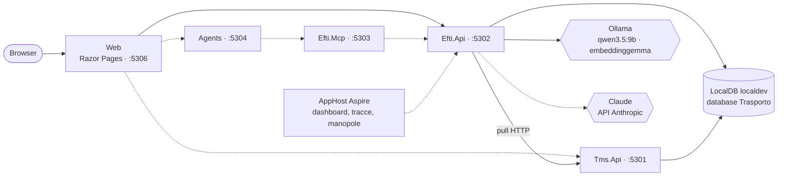
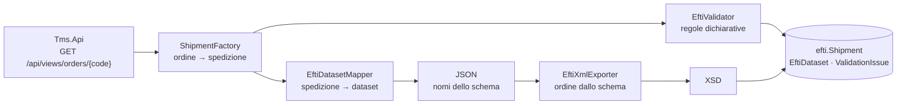

# Trasporto digitale — architettura

> Aggiornato alla **Fase 3 (importazione, mappatura e validazione eFTI)**. Il documento cresce fase per fase: descrive ciò che il repository contiene oggi e segnala ciò che è previsto ma non ancora scritto.

## 1. Che cos'è

POC dal punto di vista dell'**operatore vettore** del trasporto su strada: uno strato "eFTI-ready" sopra un TMS simulato (Release 1), poi la gestione di eccezioni e reclami (Release 2). Tutti i dati sono sintetici e fittizi.

Stato: il TMS simulato espone 156 ordini di trasporto; `Efti.Api` li importa, costruisce per ciascuno il dataset eFTI con i nomi dello schema XSD, lo valida con regole dichiarative e lo esporta in XML conforme allo schema. Ruoli e audit, tool MCP, agenti ed estrazione dai CMR arrivano con le fasi 4–7.

## 2. Topologia

Le frecce tratteggiate sono riferimenti già dichiarati nell'AppHost ma non ancora usati da codice.

| Servizio | Porta | Ruolo | Oggi |
|---|---|---|---|
| `Tms.Api` | 5301 | TMS simulato, proprietario dello schema `tms` | viste degli ordini, reset della demo |
| `Efti.Api` | 5302 | Nucleo eFTI, proprietario degli schemi `efti` e `audit` | importazione dal TMS, viste delle spedizioni, esportazione XML, `/api/health` |
| `Efti.Mcp` | 5303 | Server MCP eFTI | endpoint `/mcp` senza tool |
| `Agents` | 5304 | Agenti, client MCP, nessun accesso al database | `/`, `/health` |
| `Web` | 5306 | UI | pagina di stato |

La porta 5305 è riservata a `Claims.Mcp` (Release 2). O2C usa 5101–5106 e Sinistri 5201–5202: le tre demo possono girare insieme.

Regole di confine, valide da subito:

- ogni schema ha un solo proprietario; Web, server MCP e agenti non leggono il database;
- gli agenti agiscono solo attraverso i tool MCP;
- i provider dei modelli sono noti a un solo progetto, `Ai`: il resto vede `IChatClient` e `IEmbeddingGenerator`.

## 3. Progetti

| Progetto | Contenuto |
|---|---|
| `AppHost` | Risorse, riferimenti fra servizi, manopole |
| `ServiceDefaults` | OpenTelemetry, health check, resilienza HTTP, service discovery |
| `Shared` | Contratti e helper puri: enum e viste, `DemoCatalog`, codici d'errore, nomi di telemetria, contratti di health, regole JSON |
| `Tms.Data` | `TmsDbContext` (schema `tms`), entità, generatore dei dati sintetici e seeder |
| `Efti.Data` | `EftiDbContext` (schema `efti`) con le entità; `AuditDbContext` (schema `audit`) ancora vuoto |
| `Efti.Core` | Logica deterministica del nucleo: lettura dello schema eFTI, ordine → spedizione, mappatura nel dataset, esportazione XML, regole di validazione, documenti generati |
| `Ai` | Manopole dei modelli, fabbriche dei client, cattura dei prompt, probe di health |
| `Documents.Extraction` | Estrazione dai CMR (vuoto), libreria ospitata da `Efti.Api` |
| `Mcp.Hosting` | Composizione comune dei server MCP |
| `tools/DbInit` | Ricrea il database dal modello, senza migration, e inserisce i dati del TMS |
| `tools/Eval` | CLI: per ora il solo comando `docs`, che rigenera i documenti nati dal codice; i comandi di valutazione arrivano con la Fase 9 |

## 4. Modelli

Il modello si sceglie **per compito**. Chi ha bisogno di un modello chiede a `IChatClientFactory.Create(ModelTask)` e riceve il client già avvolto da logging e OpenTelemetry, più le opzioni di default del provider.

| Compito | Provider di default | Manopola |
|---|---|---|
| `Extraction` | `ollama` | `MODEL_EXTRACTION_PROVIDER` |
| `Mapping` | `ollama` | `MODEL_MAPPING_PROVIDER` |
| `Draft` (Release 2) | `anthropic` | `MODEL_DRAFT_PROVIDER` |
| `Judge` (Release 2) | `anthropic` | `MODEL_JUDGE_PROVIDER` |

Regole per provider:

- **Ollama**: temperatura 0,1, thinking spento, finestra di contesto da `OLLAMA_NUM_CTX` (8192), client HTTP dedicato con timeout di 10 minuti.
- **Anthropic**: `ANTHROPIC_MODEL` (`claude-haiku-4-5`) per tutti i compiti tranne il giudice, che usa `ANTHROPIC_JUDGE_MODEL` (`claude-sonnet-5-5`). La temperatura 0,1 si invia solo ai modelli Haiku 4.5; agli altri non si invia alcun parametro di campionamento.
- **Embedding**: sempre Ollama, sulla CPU (`num_gpu = 0`), per non togliere VRAM alla chat.

Con `TRASPORTO_PROMPT_CAPTURE_DIR` ogni richiesta e risposta viene salvata su file per la diagnostica. I file possono contenere dati di business: la cartella va tenuta fuori dal repository.

### Manopole

Si impostano sull'AppHost (user-secrets, riga di comando o variabili d'ambiente) e vengono inoltrate a `Efti.Api` e `Agents`; senza valore vale il default del codice (`AiOptions`).

| Manopola | Default |
|---|---|
| `OLLAMA_ENDPOINT` | `http://127.0.0.1:11434` |
| `OLLAMA_CHAT_MODEL`, `OLLAMA_NUM_CTX` | `qwen3.5:9b`, `8192` |
| `ANTHROPIC_MODEL`, `ANTHROPIC_JUDGE_MODEL` | `claude-haiku-4-5`, `claude-sonnet-5-5` |
| `MODEL_<COMPITO>_PROVIDER` | vedi tabella sopra |
| `EMBEDDING_MODEL`, `EMBEDDING_DIMENSIONS` | `embeddinggemma`, `768` |
| `TRASPORTO_PROMPT_CAPTURE_DIR` | — |

Segreti, solo negli user-secrets dell'AppHost: `ConnectionStrings:sql` e `Parameters:anthropic-api-key`. La chiave è facoltativa all'avvio: senza, i compiti locali funzionano e il controllo 9 lo segnala.

## 5. Controlli di salute

`GET /api/health` su `Efti.Api` restituisce l'esito di ogni controllo. Lo stesso report, con una cache di 30 secondi, alimenta l'health check ASP.NET (`/health`) letto da Aspire: un errore rende `efti-api` non sano nel dashboard, un avviso lo rende degradato.

| # | Controllo | Errore | Avviso |
|---|---|---|---|
| 1 | Connessione SQL | server non raggiungibile, connection string assente | — |
| 2 | Versione SQL Server | major < 17 | — |
| 3 | Supporto `VECTOR` | `VECTOR_DISTANCE` non disponibile | — |
| 4 | Database applicativo | database non indicato | database non ancora creato |
| 5 | Ollama raggiungibile | non risponde | — |
| 6 | Modello di chat presente | non installato | — |
| 7 | Modello di embedding presente | non installato | — |
| 8 | Dimensione dell'embedding | diversa da `EMBEDDING_DIMENSIONS` | — |
| 9 | Chiave Anthropic | assente con estrazione o mappatura instradate sul cloud | assente, nessun compito attivo la richiede |
| 10 | Posizionamento dei modelli | — | embedding in VRAM, chat non tutta in VRAM |
| 11 | Schema eFTI | i file XSD non si leggono o non si compilano | — |

Il controllo 9 guarda solo se la chiave è presente: non chiama l'API.

## 6. Dati

Database `Trasporto` su `(localdb)\localdev` (SQL Server 2025), con gli schemi `tms`, `efti`, `audit` e, nella Release 2, `claims` e `rag`. Il database si ricrea da zero con `tools/Dusiburg.AI.Trasporto.DbInit`: nessuna migration.

Convenzioni, verificate da un test sui metadati di tutti i `DbContext`: tabelle al singolare, PK numerica `Id`, nessuna PK GUID, chiavi di business come colonne univoche, ogni enum è una FK verso una tabella di lookup `tinyint` generata da `Enum.GetValues`.

### 6.1 Schema `tms`

| Tabella | Chiave di business | Contenuto |
|---|---|---|
| `Customer` | `Code` (`CUS-001`) | committente |
| `Vehicle` | `PlateNumber` | motrici e rimorchi |
| `Driver` | `Code` (`DRV-01`) | autista |
| `Trip` | `Code` (`TR-1001`) | motrice, rimorchio facoltativo, autista, eventuale vettore successivo |
| `TransportOrder` | `Code` (`TO-1001`) | mittente, destinatario, luoghi e date di presa e consegna, totali dichiarati, dati contrattuali |
| `TransportOrderLine` | (`TransportOrderId`, `LineNumber`) | merce, colli, imballo, peso, volume, dati ADR |
| Lookup | — | `TransportOrderStatus`, `VehicleType`, `PackageType`, `FreightPayment` |

Il TMS è **permissivo per scelta**: mittente e destinatario sono testo dell'ordine e non anagrafiche, indirizzi e descrizioni sono annullabili, il codice paese non è vincolato, i totali di testata sono dichiarati a parte dalle righe. Un TMS reale contiene dati sporchi, e nel POC devono poter esistere per essere scoperti dalla validazione eFTI.

### 6.2 Schema `efti`

| Tabella | Chiave di business | Contenuto |
|---|---|---|
| `Shipment` | `Code`; `TmsOrderCode` univoco; `PublicId` GUID univoco | copia di lavoro della spedizione |
| `Party` | — | soggetto |
| `ShipmentParty` | (`ShipmentId`, `PartyRoleId`, `Sequence`) | ruolo di un soggetto nella spedizione |
| `ConsignmentItem` | (`ShipmentId`, `SequenceNumber`) | riga di merce |
| `EftiDataset` | (`ShipmentId`, `Version`) | dataset in JSON, versione dello schema, stato |
| `ValidationIssue` | — | regola, gravità, campo e messaggio di un problema |
| Lookup | — | `PartyRole`, `DatasetStatus`, `IssueSeverity`, `PackageType`, `FreightPayment` |

Lo schema nasce vuoto: lo riempie l'importazione dal TMS (Fase 3). `TmsOrderCode` univoco rende l'importazione idempotente. `PackageType` e `FreightPayment` hanno una lookup per schema, perché uno schema non referenzia tabelle di un altro proprietario.

### 6.3 Dati del TMS

`DbInit` inserisce prima gli **ordini demo**, fissi, e poi i **dati sintetici**, generati con Bogus a seed fisso (`20261005`, sovrascrivibile con `Seed__RandomSeed`). A parità di seed e di giorno il risultato è identico; le date sono relative al giorno del seed.

| Ordine | Scenario | Tratta | Caratteristica |
|---|---|---|---|
| `TO-1001` | 1 | Segrate (IT) → Stuttgart (DE) | completa, in viaggio |
| `TO-1002` | 2 | Vigonza (IT) → Lyon (FR) | CAP e partita IVA del destinatario mancanti, riga ADR senza numero ONU, peso di testata incoerente; i dati giusti sono nelle istruzioni del mittente |
| `TO-1003` | 3 | Treviso (IT) → Ljubljana (SI) | righe senza colli né peso: il dettaglio è sul CMR |
| `TO-1004` | 4 | Livorno (IT) → València (ES) | ADR completa (UN 1263), in viaggio |
| `TO-1005` | 5 e 7 | Albino (IT) → Wien (AT) | consegnata, con valore dichiarato |
| `TO-1006` | 6 | Torino (IT) → Grenoble (FR) | consegnata tre giorni dopo la data pattuita |

I sei committenti demo sono clienti del POC Order-to-Cash, riconoscibili dalla ragione sociale. Le partite IVA sono proprie di questo POC: quelle di Order-to-Cash non superano il controllo della cifra di controllo che la validazione eFTI applica.

Dati sintetici: 30 clienti, 26 mezzi, 12 autisti, 150 ordini (`TO-2001`…`TO-2150`) per metà circa internazionali. Circa un terzo degli ordini generati porta uno o due **difetti voluti**:

| Difetto | Effetto sul dato |
|---|---|
| `MissingConsigneeAddress` | CAP e città del destinatario e del luogo di consegna vuoti |
| `MissingGoodsDescription` | descrizione della prima riga vuota |
| `MissingPackageCount` | colli della prima riga a zero |
| `WeightMismatch` | peso di testata diverso dalla somma delle righe di oltre il 5% |
| `AdrWithoutUnNumber` | riga marcata ADR senza numero ONU |
| `InvalidCountryCode` | paese del destinatario non ISO a due lettere |
| `DeliveryBeforePickup` | data di consegna pattuita precedente alla presa |

Con il seed di default: 47 ordini difettosi su 150, 59 difetti. I difetti assegnati non sono una tabella: `DbInit` ne stampa la distribuzione e un test verifica, ordine per ordine, che ogni difetto assegnato si veda nel dato e che non ce ne siano altri.

Identificativi fittizi: targhe con prefisso `ZZ` e `XZ` (serie non assegnate), partite IVA italiane generate con codice ufficio `000` (inesistente) e cifra di controllo corretta, partite IVA estere con il blocco `999`, email sul dominio riservato `.example`.

### 6.4 API del TMS

| Endpoint | Scopo |
|---|---|
| `GET /api/views/orders?status=&customerCode=` | elenco, al più 200 righe, dal più recente |
| `GET /api/views/orders/{code}` | dettaglio completo: è il dato che `Efti.Api` legge nell'importazione, lacune comprese |
| `POST /dev/reset` | solo in Development: riporta il TMS al seed |

Gli errori sono `ProblemDetails` con l'estensione `code` (`NOT_FOUND`, `VALIDATION_ERROR`, `CONFLICT`, `UNAUTHORIZED`, `UPSTREAM_UNAVAILABLE`, `INTERNAL`).

## 7. Nucleo eFTI

### 7.1 Lo schema come fonte

Lo schema XSD di riferimento (`consignment-common.xsd` 0.8, Apache-2.0) è copiato senza modifiche in `data/efti-schema/v0/`, con l'attribuzione in `data/efti-schema/README.md`. `EftiSchemaCatalog` lo legge e ne ricava, per ogni elemento, nome, tipo, cardinalità, identificativo eFTI, formato, definizione e sottoinsiemi con il loro stato, oltre alla lista dei codici paese. Nomi, identificativi, formati e sottoinsiemi non sono scritti a mano in nessun punto del codice.

Un elemento appartiene a un sottoinsieme se la sua annotazione lo elenca, come fanno gli strumenti di riferimento. Lo stato (`M`, `C`, `O`, `SI`) è riportato com'è: il significato ufficiale di `SI` non è stato verificato sul regolamento.

Lo schema dichiara **facoltativo ogni elemento**: la conformità all'XSD controlla struttura, ordine, tipi, lunghezze e liste di codici, non l'obbligatorietà. Quella la danno le regole.

### 7.2 Dall'ordine al dataset

- **`ShipmentFactory`** copia l'ordine del TMS in una spedizione così com'è, lacune ed errori compresi, e aggiunge il vettore dalla configurazione (`Carrier`).
- **`EftiDatasetMapper`** è una funzione pura: non corregge e non inventa. Un dato mancante resta fuori dal dataset, un dato sbagliato ci entra com'è.
- Il **JSON** salvato in `efti.EftiDataset` usa i nomi degli elementi dello schema. Un elemento ripetibile è un array; un valore con attributo (unità, valuta, formato) è un oggetto `{ "value": …, "unitId": … }`.
- **`EftiXmlExporter`** è guidato dallo schema: l'ordine degli elementi e la distinzione fra contenitori e valori vengono dal catalogo. Un nome che lo schema non conosce è un errore, quindi il JSON non può divergere dai nomi dello schema.

Particolarità dello schema che la mappatura rispetta: le righe di merce non hanno descrizione né peso propri (natura della merce, colli e peso stanno sulla spedizione; la riga porta volume e merci pericolose); la partita IVA sta in `taxRegistration/id`, che non è nei sottoinsiemi dell'autorità; le date hanno un formato proprio (`102` = `CCYYMMDD`, `205` = `CCYYMMDDHHMM±HHMM`).

La copertura è dichiarata in `DatasetCoverage` e documentata in [copertura-dataset.md](copertura-dataset.md), generato dallo schema: 63 elementi coperti, e l'elenco dei 93 elementi dei sottoinsiemi `EU03` ed `EU05a` che il POC non valorizza (limitato ai contenitori che il POC usa).

### 7.3 Validazione

Le regole sono un elenco dichiarativo (`ValidationRules`): codice, categoria, gravità, elemento eFTI, spiegazione. Sono 29, di cui 26 bloccanti, in cinque categorie: obbligatorietà (`M-`), formato (`F-`), coerenza (`C-`), avvisi (`W-`), conformità allo schema (`X-`). L'elenco completo è in [regole-di-validazione.md](regole-di-validazione.md), generato dal codice.

Un dataset è `Valid` quando nessuna regola bloccante è violata **e** l'XML esportato è conforme allo schema; altrimenti è `Incomplete`. Gli avvisi non cambiano lo stato. La conformità allo schema si controlla solo se le altre regole passano: intercetta ciò che le regole non prevedono (per esempio un testo più lungo del formato) senza duplicare i loro messaggi.

Nessun modello partecipa alla validazione. Il golden set `data/golden_validation.json` (34 casi) deve passare al 100%, e copre ogni regola.

### 7.4 API

| Endpoint | Scopo |
|---|---|
| `POST /api/shipments/import` | corpo `{ "orderCode": "TO-1001" }` per un ordine; senza corpo, tutti gli ordini non annullati |
| `GET /api/views/shipments?status=` | elenco con stato del dataset e numero di problemi |
| `GET /api/views/shipments/{code}` | dettaglio con soggetti, righe, dataset JSON e problemi |
| `GET /api/shipments/{code}/dataset.xml` | XML del dataset; l'intestazione `X-Efti-Dataset-Status` ne dice lo stato |
| `POST /dev/reset` | solo in Development: svuota lo schema `efti` |

L'importazione è **idempotente sul codice dell'ordine**: una spedizione già importata non viene riletta né toccata, perché da quel momento il dataset cambia solo con una decisione umana registrata. Gli ordini annullati non diventano spedizioni. Con il seed di default: 147 spedizioni, 100 `Valid` e 47 `Incomplete`.

### 7.5 Documenti generati

`docs/regole-di-validazione.md` e `docs/copertura-dataset.md` nascono dal codice e si rigenerano con `dotnet run --project tools/Dusiburg.AI.Trasporto.Eval -- docs`. Un test confronta i file con ciò che il codice produce: se una regola o la copertura cambiano senza rigenerare, la build dei test fallisce.

## 8. Test e CI

- `Ai.Tests`: manopole, fabbriche dei client, aggregazione dei controlli. Nessuna chiamata a un modello.
- `Efti.Core.Tests`: catalogo dello schema; mappatura; esportazione XML e conformità all'XSD; regole sugli ordini demo, sui difetti del seed (esiti esatti) e sul golden set; allineamento dei documenti generati e della copertura dichiarata. Nessun database.
- `Efti.Api.Tests`: endpoint con probe finti; controlli SQL veri su un database usa-e-getta creato da `DbInit`; convenzioni del modello dati su tutti i `DbContext`; schemi, lookup e vincoli dello schema `efti`; importazione, viste ed esportazione con un TMS finto.
- `Tms.Api.Tests`: invarianti degli ordini demo; generatore dei dati sintetici (ripetibilità, dimensioni, difetti); viste e reset su un database usa-e-getta.
- La CI gira su Windows con LocalDB. I test della categoria `RequiresSql2025` si saltano se LocalDB è più vecchio della versione 17 e restano obbligatori in locale.

## 9. Decisioni

Gli identificativi sono quelli del piano di progetto.

| # | Decisione | Alternativa scartata |
|---|---|---|
| G6 | Repository separato da O2C e Sinistri; i loro pattern sono copiati e adattati | Monorepo |
| G9 | LocalDB `localdev`, Ollama nativo, `DbInit` senza migration | Container e migration |
| G10 | EF Core per la parte relazionale, Dapper solo per le query vettoriali | Un solo accesso ai dati |
| G11 | Agent Framework, MCP C# SDK, Claude via API Anthropic, `qwen3.5:9b` ed `embeddinggemma` in locale | Azure OpenAI |
| P1 | Un `DbContext` per schema | Un solo schema |
| P2 | Ingestione dal TMS con pull HTTP, niente broker | RabbitMQ come in O2C |
| P3 | `Documents.Extraction` e `Ai` sono librerie ospitate da `Efti.Api` | Un servizio per componente |
| P4 | Gli agenti stanno in un servizio a parte, client MCP, senza database | Agenti dentro `Efti.Api` |
| P8 | Porte locali 5301–5306 | — |
| D2 | NUnit resta alla 4.6.1 | NUnit 5.0.0, appena uscita |
| D3 | Cloud di default `claude-haiku-4-5`, giudice `claude-sonnet-5-5` | Un solo modello cloud |
| F1.1 | Il modello si chiede alla fabbrica per compito; nessun `IChatClient` registrato nel contenitore | Un client unico, come in O2C: non permette il routing per compito |
| F1.2 | La chiave Anthropic è facoltativa all'avvio dell'AppHost | Parametro obbligatorio: la demo locale non partirebbe senza chiave |
| F1.3 | Nessun correlation id applicativo: l'audit userà il trace id di OpenTelemetry | Correlation id come in O2C |
| F2.1 | Il TMS accetta dati sporchi (campi annullabili, paese non vincolato, totali di testata separati dalle righe) | Vincoli nel TMS: i difetti non potrebbero esistere e la validazione eFTI non avrebbe nulla da trovare |
| F2.2 | Mittente e destinatario sono colonne dell'ordine, non anagrafiche | Anagrafica dei soggetti nel TMS: più pulita, ma nasconde il problema reale |
| F2.3 | I difetti assegnati restano nel risultato del generatore | Tabella dei difetti attesi nel database: sarebbe un dato che un TMS vero non ha |
| F2.4 | Le spedizioni demo nascono come ordini del TMS e diventano spedizioni con l'importazione | Seed diretto dello schema `efti`: salterebbe il flusso che la demo deve mostrare |
| F2.5 | Il generatore sta in `Tms.Data`, accanto al seeder | Un progetto di ingestione separato, come in Sinistri: qui serve anche a `POST /dev/reset` |
| D5 | Lo schema XSD eFTI è la fonte di nomi, identificativi, formati e sottoinsiemi | Tabella dei campi scritta a mano |
| F3.1 | Schema `v0`, `consignment-common.xsd` 0.8 | `v1`: organizzato per messaggio, struttura diversa, sottoinsiemi senza stato |
| F3.2 | `Efti.Core` lavora sul grafo delle entità di `Efti.Data` in memoria, senza `DbContext` | Un modello intermedio proprio di `Efti.Core`: un terzo modello parallelo da tenere allineato |
| F3.3 | L'esportazione XML è guidata dallo schema a partire dal JSON | XML scritto campo per campo: ordine e nomi andrebbero mantenuti a mano |
| F3.4 | La conformità all'XSD si controlla solo se nessuna regola bloccante è violata | Controllarla sempre: per lo stesso difetto un messaggio comprensibile e uno dell'XSD |
| F3.5 | Una spedizione importata non si reimporta | Aggiornarla a ogni importazione: il dataset cambierebbe senza una decisione umana |
| F3.6 | Mapper e importazione non correggono il dato | Normalizzare in ingresso: nasconderebbe i difetti che la demo deve mostrare e risolvere con una decisione registrata |
| F3.7 | I codici non verificabili sullo schema sono dichiarati tali; il tipo di mezzo (obbligatorio in `EU03`) resta non coperto | Scrivere un codice non verificato in un campo obbligatorio |

### Versioni

.NET 10 (SDK 10.0.400, `latestFeature`), Aspire 13.6.0, EF Core 10.0.12, `Microsoft.Extensions.AI` 10.10.0, `Microsoft.Agents.AI` 1.23.0, `ModelContextProtocol` 2.2.0, `Anthropic` 12.53.0, `OllamaSharp` 5.5.0, Bogus 35.6.5, OpenTelemetry 1.19.1 (pacchetti di strumentazione 1.19.0), NUnit 4.6.1.
