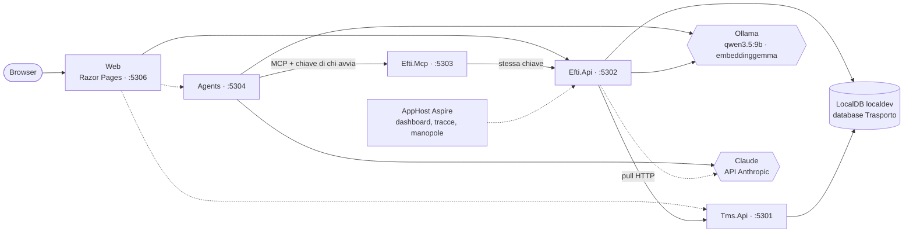
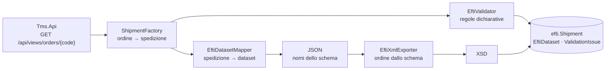
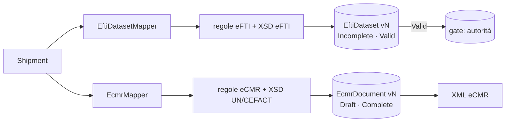
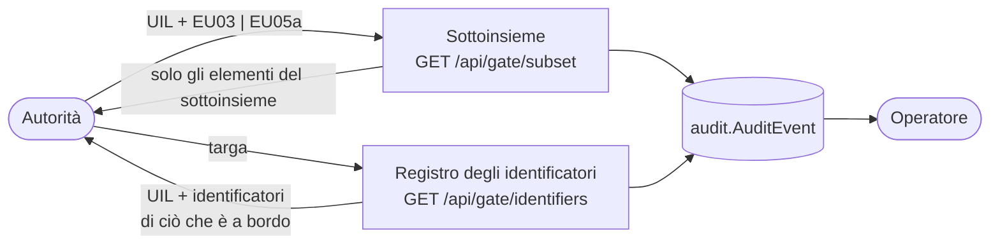
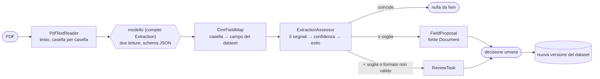
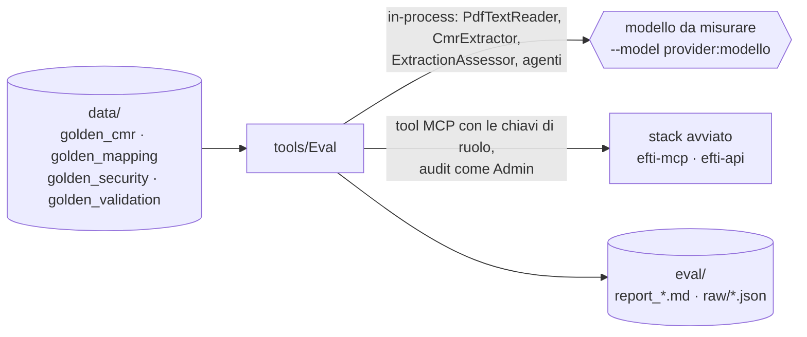

# Trasporto digitale — architettura

> Aggiornato alla **Fase 9 (valutazione e documentazione): è lo stato della Release 1**. Il documento cresce fase per fase: descrive ciò che il repository contiene oggi e segnala ciò che è previsto ma non ancora scritto.

## 1. Che cos'è

POC dal punto di vista dell'**operatore vettore** del trasporto su strada: uno strato "eFTI-ready" sopra un TMS simulato (Release 1), poi la gestione di eccezioni e reclami (Release 2). Tutti i dati sono sintetici e fittizi.

Stato: il TMS simulato espone 156 ordini di trasporto; `Efti.Api` li importa, costruisce per ciascuno il dataset eFTI con i nomi dello schema XSD, lo valida con regole dichiarative e lo esporta in XML conforme allo schema. Ogni operazione di `Efti.Api` richiede un ruolo e lascia una riga in un audit che il database non permette di modificare; l'autorità arriva a una spedizione solo da una targa, attraverso il registro degli identificatori. Un server MCP espone sette tool con gli stessi permessi dell'API, e due agenti li usano con la chiave di chi li avvia: uno propone i completamenti di una spedizione incompleta, l'altro risponde alle domande di un controllo su strada dai soli sottoinsiemi. Dal CMR in PDF di una spedizione un modello estrae i campi e il codice ne calcola la confidenza: sopra soglia diventano proposte, sotto soglia vanno in una coda di revisione. Il dataset cambia solo quando una persona accetta una proposta o conferma una revisione. Dalla stessa spedizione nasce anche il **documento eCMR** (la lettera di vettura elettronica), con mappatura, regole e stato propri, esportato nell'XML UN/CEFACT e validato con il suo XSD (§7.6).

## 2. Topologia

Le frecce tratteggiate sono riferimenti già dichiarati nell'AppHost ma non ancora usati da codice.

| Servizio | Porta | Ruolo | Oggi |
|---|---|---|---|
| `Tms.Api` | 5301 | TMS simulato, proprietario dello schema `tms` | viste degli ordini, reset della demo |
| `Efti.Api` | 5302 | Nucleo eFTI, proprietario degli schemi `efti` e `audit` | importazione dal TMS, viste delle spedizioni, esportazione XML, `/api/health` |
| `Efti.Mcp` | 5303 | Server MCP eFTI | endpoint `/mcp` raggiungibile solo con la chiave di un ruolo, sette tool filtrati per ruolo |
| `Agents` | 5304 | Agenti, client MCP, nessun accesso al database | agente di mappatura e agente autorità, risposta unica o stream SSE |
| `Web` | 5306 | UI | scenari 1–4 dal browser, selettore di ruolo, pagina di stato (§12) |

La porta 5305 è riservata a `Claims.Mcp` (Release 2). O2C usa 5101–5106 e Sinistri 5201–5202: le tre demo possono girare insieme.

Regole di confine, valide da subito:

- ogni schema ha un solo proprietario; Web, server MCP e agenti non leggono il database;
- gli agenti agiscono solo attraverso i tool MCP;
- i provider dei modelli sono noti a un solo progetto, `Ai`: il resto vede `IChatClient` e `IEmbeddingGenerator`.

## 3. Progetti

| Progetto | Contenuto |
|---|---|
| `AppHost` | Risorse, riferimenti fra servizi, manopole |
| `ServiceDefaults` | OpenTelemetry, health check, resilienza HTTP, service discovery |
| `Shared` | Contratti e helper puri: enum e viste, `DemoCatalog`, codici d'errore, nomi di telemetria, contratti di health, regole JSON |
| `Tms.Data` | `TmsDbContext` (schema `tms`), entità, generatore dei dati sintetici e seeder |
| `Efti.Data` | `EftiDbContext` (schema `efti`) con le entità; `AuditDbContext` (schema `audit`) ancora vuoto |
| `Efti.Core` | Logica deterministica del nucleo: lettura dello schema eFTI, ordine → spedizione, mappatura nel dataset, esportazione XML, regole di validazione, documenti generati |
| `Ai` | Manopole dei modelli, fabbriche dei client, mascheramento verso il cloud, cattura dei prompt, probe di health |
| `Agents` | I due agenti, le loro specifiche (`Specs/*.agent.md`), la guardia sui tool, il controllo di riconducibilità alla fonte, gli endpoint |
| `Documents.Extraction` | Testo dal PDF (PdfPig) ed estrazione tipizzata del CMR con il modello; libreria ospitata da `Efti.Api`, senza logica di dominio |
| `Mcp.Hosting` | Composizione comune dei server MCP: trasporto, chiave di ruolo, elenco dei tool filtrato per ruolo, span ed errori strutturati su ogni chiamata |
| `Efti.Mcp` | Server MCP eFTI: sette tool sopra `Efti.Api`, senza database e senza identità propria |
| `Web` | UI Razor Pages: selettore di ruolo, pagine degli scenari, inoltro degli stream degli agenti; solo HTTP verso `Efti.Api` e `Agents` |
| `tools/DbInit` | Ricrea il database dal modello, senza migration, e inserisce i dati del TMS |
| `tools/Eval` | CLI: `docs` rigenera i documenti nati dal codice, `cmr` e `golden` i CMR sintetici e il golden set (PDFsharp-MigraDoc e PDFtoImage stanno solo qui); `eval validation`, `eval extraction`, `eval security` e `bench models` misurano e scrivono i report di `eval/` (§14) |

## 4. Modelli

Il modello si sceglie **per compito**. Chi ha bisogno di un modello chiede a `IChatClientFactory.Create(ModelTask)` e riceve il client già avvolto da logging e OpenTelemetry, più le opzioni di default del provider.

| Compito | Provider di default | Manopola |
|---|---|---|
| `Extraction` | `ollama` | `MODEL_EXTRACTION_PROVIDER` |
| `Mapping` | `ollama` | `MODEL_MAPPING_PROVIDER` |
| `Draft` (Release 2) | `anthropic` | `MODEL_DRAFT_PROVIDER` |
| `Judge` (Release 2) | `anthropic` | `MODEL_JUDGE_PROVIDER` |
| `Authority` | `ollama` | `MODEL_AUTHORITY_PROVIDER` |

Regole per provider:

- **Ollama**: temperatura 0,1, thinking spento, finestra di contesto da `OLLAMA_NUM_CTX` (8192), tutti i layer in GPU con `OLLAMA_NUM_GPU` (99), client HTTP dedicato con timeout di 10 minuti. È quello installato sul PC: se all'avvio non risponde, l'AppHost lo avvia come propria risorsa (`ollama serve`) e lo ferma quando si chiude; se è già in esecuzione non lo tocca. Vale solo per un `OLLAMA_ENDPOINT` locale.
- **Anthropic**: `ANTHROPIC_MODEL` (`claude-haiku-5-5`; fino al 2026-10-14 `claude-haiku-4-5`) per tutti i compiti tranne il giudice, che usa `ANTHROPIC_JUDGE_MODEL` (`claude-sonnet-5-5`). La temperatura 0,1 si invia solo ai modelli Haiku 4.5; agli altri non si invia alcun parametro di campionamento (Haiku 5.5, Sonnet 5.5 e Opus 5.5 rispondono 400). Haiku 5.5 ragiona sempre con l'adaptive thinking (effort di default `medium`), che conta nei token di uscita.
- **Embedding**: sempre Ollama, sulla CPU (`num_gpu = 0`), per non togliere VRAM alla chat.
- **Mascheramento verso il cloud**: con il provider `anthropic` email e numeri di telefono, nei messaggi e nei risultati dei tool, partono come `[email]` e `[telefono]`. Si maschera la copia inviata: il codice che controlla i valori vede i dati veri. Un telefono si riconosce solo in forma internazionale o se annunciato (`tel`, `cell`, …), perché CAP, numeri ONU e partite IVA al modello servono. I nomi di persone fisiche non si riconoscono in modo affidabile e non vengono toccati: i dati del POC non ne contengono.

Con `TRASPORTO_PROMPT_CAPTURE_DIR` ogni richiesta e risposta viene salvata su file per la diagnostica. I file possono contenere dati di business: la cartella va tenuta fuori dal repository.

### Manopole

Si impostano sull'AppHost (user-secrets, riga di comando o variabili d'ambiente) e vengono inoltrate a `Efti.Api` e `Agents`; senza valore vale il default del codice (`AiOptions`).

| Manopola | Default |
|---|---|
| `OLLAMA_ENDPOINT` | `http://127.0.0.1:11434` |
| `OLLAMA_CHAT_MODEL`, `OLLAMA_NUM_CTX` | `qwen3.5:9b`, `8192` |
| `OLLAMA_NUM_GPU` | `99` (chat tutta in GPU; `auto` = margine automatico di Ollama, che dalla 0.40 su 8 GB lascia un layer sulla CPU) |
| `ANTHROPIC_MODEL`, `ANTHROPIC_JUDGE_MODEL` | `claude-haiku-5-5`, `claude-sonnet-5-5` |
| `MODEL_<COMPITO>_PROVIDER` | vedi tabella sopra |
| `EMBEDDING_MODEL`, `EMBEDDING_DIMENSIONS` | `embeddinggemma`, `768` |
| `TRASPORTO_PROMPT_CAPTURE_DIR` | — |

Segreti, solo negli user-secrets dell'AppHost: `ConnectionStrings:sql` e `Parameters:anthropic-api-key`. La chiave è facoltativa all'avvio: senza, i compiti locali funzionano e il controllo 9 lo segnala.

## 5. Controlli di salute

`GET /api/health` su `Efti.Api` restituisce l'esito di ogni controllo. Lo stesso report, con una cache di 30 secondi, alimenta l'health check ASP.NET (`/health`) letto da Aspire: un errore rende `efti-api` non sano nel dashboard, un avviso lo rende degradato.

| # | Controllo | Errore | Avviso |
|---|---|---|---|
| 1 | Connessione SQL | server non raggiungibile, connection string assente | — |
| 2 | Versione SQL Server | major < 17 | — |
| 3 | Supporto `VECTOR` | `VECTOR_DISTANCE` non disponibile | — |
| 4 | Database applicativo | database non indicato | database non ancora creato |
| 5 | Ollama raggiungibile | non risponde | — |
| 6 | Modello di chat presente | non installato | — |
| 7 | Modello di embedding presente | non installato | — |
| 8 | Dimensione dell'embedding | diversa da `EMBEDDING_DIMENSIONS` | — |
| 9 | Chiave Anthropic | assente con estrazione o mappatura instradate sul cloud | assente, nessun compito attivo la richiede |
| 10 | Posizionamento dei modelli | — | embedding in VRAM, chat non tutta in VRAM |
| 11 | Schema eFTI | i file XSD non si leggono o non si compilano | — |
| 12 | Chiavi di ruolo | — | un ruolo non ha la sua chiave e non può autenticarsi |
| 13 | Schema eCMR | i file XSD UN/CEFACT non si leggono o non si compilano | — |

Il controllo 9 guarda solo se la chiave è presente: non chiama l'API.

## 6. Dati

Database `Trasporto` su `(localdb)\localdev` (SQL Server 2025), con gli schemi `tms`, `efti`, `audit` e, nella Release 2, `claims` e `rag`. Il database si ricrea da zero con `tools/Dusiburg.AI.Trasporto.DbInit`: nessuna migration.

Convenzioni, verificate da un test sui metadati di tutti i `DbContext`: tabelle al singolare, PK numerica `Id`, nessuna PK GUID, chiavi di business come colonne univoche, ogni enum è una FK verso una tabella di lookup `tinyint` generata da `Enum.GetValues`.

### 6.1 Schema `tms`

| Tabella | Chiave di business | Contenuto |
|---|---|---|
| `Customer` | `Code` (`CUS-001`) | committente |
| `Vehicle` | `PlateNumber` | motrici e rimorchi |
| `Driver` | `Code` (`DRV-01`) | autista |
| `Trip` | `Code` (`TR-1001`) | motrice, rimorchio facoltativo, autista, eventuale vettore successivo |
| `TransportOrder` | `Code` (`TO-1001`) | mittente, destinatario, luoghi e date di presa e consegna, totali dichiarati, dati contrattuali; luogo e data di emissione della lettera di vettura, istruzioni doganali |
| `TransportOrderLine` | (`TransportOrderId`, `LineNumber`) | merce, colli, imballo, peso, volume, dati ADR, contrassegni e numeri dei colli |
| `TransportOrderDocument` | (`TransportOrderId`, `Sequence`) | documento consegnato al vettore: tipo (UN/EDIFACT 1001) e numero |
| Lookup | — | `TransportOrderStatus`, `VehicleType`, `PackageType`, `FreightPayment` |

Il TMS è **permissivo per scelta**: mittente e destinatario sono testo dell'ordine e non anagrafiche, indirizzi e descrizioni sono annullabili, il codice paese non è vincolato, i totali di testata sono dichiarati a parte dalle righe. Un TMS reale contiene dati sporchi, e nel POC devono poter esistere per essere scoperti dalla validazione eFTI.

### 6.2 Schema `efti`

| Tabella | Chiave di business | Contenuto |
|---|---|---|
| `Shipment` | `Code`; `TmsOrderCode` univoco; `PublicId` GUID univoco | copia di lavoro della spedizione |
| `Party` | — | soggetto |
| `ShipmentParty` | (`ShipmentId`, `PartyRoleId`, `Sequence`) | ruolo di un soggetto nella spedizione |
| `ConsignmentItem` | (`ShipmentId`, `SequenceNumber`) | riga di merce |
| `EftiDataset` | (`ShipmentId`, `Version`) | dataset in JSON, versione dello schema, stato |
| `ValidationIssue` | — | regola, gravità, campo e messaggio di un problema |
| `AccompanyingDocument` | (`ShipmentId`, `Sequence`) | documento consegnato al vettore insieme alla merce |
| `EcmrDocument` | (`ShipmentId`, `Version`) | documento eCMR in JSON, versione dello schema UN/CEFACT, stato; stessa versione del dataset eFTI nato nello stesso momento |
| `EcmrIssue` | — | regola, gravità, elemento e messaggio di un problema dell'eCMR |
| `IdentifierRegistryEntry` | `Uil` univoco; una riga per spedizione | voce del registro degli identificatori: UIL, targhe normalizzate, sottoinsieme degli identificatori in JSON |
| `FieldProposal` | — | proposta di completamento di un campo: valore proposto e valore di allora, fonte, motivazione, chi l'ha fatta, chi l'ha decisa, versione del dataset che ne è nata |
| `Document` | — | documento caricato su una spedizione: file, impronta SHA-256, testo letto, chi e quando |
| `ExtractionResult` | una per documento | modello, letture, tempi, token, soglia e pesi in vigore, risposta grezza |
| `ExtractionField` | — | campo estratto: valore, valore normalizzato, valore della spedizione, cinque segnali, confidenza, esito, proposta collegata |
| `ReviewTask` | una per campo | voce della coda di revisione: stato, chi ha deciso, valore corretto, nota |
| Lookup | — | `PartyRole`, `DatasetStatus`, `EcmrStatus`, `IssueSeverity`, `PackageType`, `FreightPayment`, `ProposalStatus`, `ProposalSource`, `ExtractionFieldOutcome`, `ReviewStatus` |

Lo schema nasce vuoto: lo riempie l'importazione dal TMS (Fase 3). `TmsOrderCode` univoco rende l'importazione idempotente. `PackageType` e `FreightPayment` hanno una lookup per schema, perché uno schema non referenzia tabelle di un altro proprietario.

### 6.3 Dati del TMS

`DbInit` inserisce prima gli **ordini demo**, fissi, e poi i **dati sintetici**, generati con Bogus a seed fisso (`20261005`, sovrascrivibile con `Seed__RandomSeed`). A parità di seed e di giorno il risultato è identico; le date sono relative al giorno del seed.

| Ordine | Scenario | Tratta | Caratteristica |
|---|---|---|---|
| `TO-1001` | 1 | Segrate (IT) → Stuttgart (DE) | completa, in viaggio |
| `TO-1002` | 2 | Vigonza (IT) → Lyon (FR) | CAP e partita IVA del destinatario mancanti, riga ADR senza numero ONU, peso di testata incoerente; i dati giusti sono nelle istruzioni del mittente |
| `TO-1003` | 3 | Treviso (IT) → Ljubljana (SI) | righe senza colli né peso: il dettaglio è sul CMR |
| `TO-1004` | 4 | Livorno (IT) → València (ES) | ADR completa (UN 1263), in viaggio |
| `TO-1005` | 5 e 7 | Albino (IT) → Wien (AT) | consegnata da due giorni, con valore dichiarato; non più a bordo, ma ancora leggibile con il suo UIL |
| `TO-1006` | 6 | Torino (IT) → Grenoble (FR) | consegnata da nove giorni, tre dopo la data pattuita; sul gate è scaduta |

I sei committenti demo sono clienti del POC Order-to-Cash, con la stessa ragione sociale e la stessa partita IVA: è il filo "ordine → spedizione" del portfolio. Le partite IVA sono fittizie ma formalmente corrette (ufficio `000`, cifra di controllo valida), perché la validazione eFTI le controlla; il catalogo di Order-to-Cash è stato allineato agli stessi valori.

Dati sintetici: 30 clienti, 50 mezzi (26 fra trattori e motrici, 24 rimorchi), 12 autisti, 150 ordini (`TO-2001`…`TO-2150`) per metà circa internazionali.

I **viaggi sono coerenti nel tempo**: un mezzo fa un viaggio alla volta e riparte solo dal giorno dopo l'ultima consegna del precedente; ogni trattore ha il suo rimorchio. Un viaggio porta da uno a tre ordini caricati a non più di un giorno l'uno dall'altro (collettame). Così, a una certa ora, ciò che un mezzo ha a bordo è il carico di un solo viaggio: è quello che deve trovare un controllo su strada. Un test lo verifica per ogni mezzo, a ogni presa in carico.

Circa un terzo degli ordini generati porta uno o due **difetti voluti**:

| Difetto | Effetto sul dato |
|---|---|
| `MissingConsigneeAddress` | CAP e città del destinatario e del luogo di consegna vuoti |
| `MissingGoodsDescription` | descrizione della prima riga vuota |
| `MissingPackageCount` | colli della prima riga a zero |
| `WeightMismatch` | peso di testata diverso dalla somma delle righe di oltre il 5% |
| `AdrWithoutUnNumber` | riga marcata ADR senza numero ONU |
| `InvalidCountryCode` | paese del destinatario non ISO a due lettere |
| `DeliveryBeforePickup` | data di consegna pattuita precedente alla presa |

I mezzi dei viaggi demo sono riservati a quei viaggi, così una targa demo porta a una sola spedizione. I difetti assegnati non sono una tabella: `DbInit` ne stampa la distribuzione e un test verifica, ordine per ordine, che ogni difetto assegnato si veda nel dato e che non ce ne siano altri.

Identificativi fittizi: targhe con prefisso `ZZ` e `XZ` (serie non assegnate), partite IVA italiane generate con codice ufficio `000` (inesistente) e cifra di controllo corretta, partite IVA estere con il blocco `999`, email sul dominio riservato `.example`.

### 6.4 API del TMS

| Endpoint | Scopo |
|---|---|
| `GET /api/views/orders?status=&customerCode=` | elenco, al più 200 righe, dal più recente |
| `GET /api/views/orders/{code}` | dettaglio completo: è il dato che `Efti.Api` legge nell'importazione, lacune comprese |
| `POST /dev/reset` | solo in Development: riporta il TMS al seed |

Gli errori sono `ProblemDetails` con l'estensione `code` (`NOT_FOUND`, `VALIDATION_ERROR`, `CONFLICT`, `UNAUTHORIZED`, `UPSTREAM_UNAVAILABLE`, `INTERNAL`).

## 7. Nucleo eFTI

### 7.1 Lo schema come fonte

Lo schema XSD di riferimento (`consignment-common.xsd` 0.8, Apache-2.0) è copiato senza modifiche in `data/efti-schema/v0/`, con l'attribuzione in `data/efti-schema/README.md`. `EftiSchemaCatalog` lo legge e ne ricava, per ogni elemento, nome, tipo, cardinalità, identificativo eFTI, formato, definizione e sottoinsiemi con il loro stato, oltre alla lista dei codici paese. Nomi, identificativi, formati e sottoinsiemi non sono scritti a mano in nessun punto del codice.

Un elemento appartiene a un sottoinsieme se la sua annotazione lo elenca, come fanno gli strumenti di riferimento. Lo stato (`M`, `C`, `O`, `SI`) è riportato com'è: il significato ufficiale di `SI` non è stato verificato sul regolamento.

Lo schema dichiara **facoltativo ogni elemento**: la conformità all'XSD controlla struttura, ordine, tipi, lunghezze e liste di codici, non l'obbligatorietà. Quella la danno le regole.

### 7.2 Dall'ordine al dataset

- **`ShipmentFactory`** copia l'ordine del TMS in una spedizione così com'è, lacune ed errori compresi, e aggiunge il vettore dalla configurazione (`Carrier`).
- **`EftiDatasetMapper`** è una funzione pura: non corregge e non inventa. Un dato mancante resta fuori dal dataset, un dato sbagliato ci entra com'è.
- Il **JSON** salvato in `efti.EftiDataset` usa i nomi degli elementi dello schema. Un elemento ripetibile è un array; un valore con attributo (unità, valuta, formato) è un oggetto `{ "value": …, "unitId": … }`.
- **`EftiXmlExporter`** è guidato dallo schema: l'ordine degli elementi e la distinzione fra contenitori e valori vengono dal catalogo. Un nome che lo schema non conosce è un errore, quindi il JSON non può divergere dai nomi dello schema.

Particolarità dello schema che la mappatura rispetta: le righe di merce non hanno descrizione né peso propri (natura della merce, colli e peso stanno sulla spedizione; la riga porta volume e merci pericolose); la partita IVA sta in `taxRegistration/id`, che non è nei sottoinsiemi dell'autorità; le date hanno un formato proprio (`102` = `CCYYMMDD`, `205` = `CCYYMMDDHHMM±HHMM`).

La copertura è dichiarata in `DatasetCoverage` e documentata in [copertura-dataset.md](copertura-dataset.md), generato dallo schema: 64 elementi coperti, e l'elenco dei 92 elementi dei sottoinsiemi `EU03` ed `EU05a` che il POC non valorizza (limitato ai contenitori che il POC usa).

### 7.3 Validazione

Le regole sono un elenco dichiarativo (`ValidationRules`): codice, categoria, gravità, elemento eFTI, spiegazione. Sono 29, di cui 26 bloccanti, in cinque categorie: obbligatorietà (`M-`), formato (`F-`), coerenza (`C-`), avvisi (`W-`), conformità allo schema (`X-`). L'elenco completo è in [regole-di-validazione.md](regole-di-validazione.md), generato dal codice.

Un dataset è `Valid` quando nessuna regola bloccante è violata **e** l'XML esportato è conforme allo schema; altrimenti è `Incomplete`. Gli avvisi non cambiano lo stato. La conformità allo schema si controlla solo se le altre regole passano: intercetta ciò che le regole non prevedono (per esempio un testo più lungo del formato) senza duplicare i loro messaggi.

Nessun modello partecipa alla validazione. Il golden set `data/golden_validation.json` (34 casi) deve passare al 100%, e copre ogni regola.

### 7.4 API

| Endpoint | Scopo |
|---|---|
| `POST /api/shipments/import` | corpo `{ "orderCode": "TO-1001" }` per un ordine; senza corpo, tutti gli ordini non annullati |
| `GET /api/views/shipments?status=&customer=&from=&to=` | elenco con stato del dataset e numero di problemi; `customer` è parte del nome di mittente o destinatario, `from` e `to` la presa in carico prevista |
| `GET /api/shipments/{code}/tms-order` | l'ordine di origine, letto ora dal TMS |
| `GET /api/views/shipments/{code}` | dettaglio con soggetti, righe, dataset JSON e problemi |
| `GET /api/shipments/{code}/dataset.xml` | XML del dataset; l'intestazione `X-Efti-Dataset-Status` ne dice lo stato |
| `GET /api/settings` | la configurazione in vigore, in sola lettura: modello per compito, pesi e soglia dell'estrazione, permanenza sul gate. Nessun segreto |
| `POST /dev/reset` | solo in Development: svuota lo schema `efti` |

L'importazione è **idempotente sul codice dell'ordine**: una spedizione già importata non viene riletta né toccata, perché da quel momento il dataset cambia solo con una decisione umana registrata. Gli ordini annullati non diventano spedizioni. Con il seed di default: 149 spedizioni, 100 `Valid` e 49 `Incomplete`.

### 7.5 Documenti generati

`docs/regole-di-validazione.md`, `docs/copertura-dataset.md`, `docs/ruoli.md` e `docs/regole-ecmr.md` nascono dal codice e si rigenerano con `dotnet run --project tools/Dusiburg.AI.Trasporto.Eval -- docs`. Un test confronta i file con ciò che il codice produce: se una regola o la copertura cambiano senza rigenerare, la build dei test fallisce.

### 7.6 eCMR parallelo al dataset eFTI (Fase 8b)

L'eCMR è il **contratto di trasporto** in forma elettronica; il dataset eFTI è l'informazione che l'autorità deve poter leggere. Non sono l'uno un sottoinsieme dell'altro, quindi dalla stessa `Shipment` nascono due prodotti indipendenti:

Nascono e si rigenerano negli stessi due punti, con lo **stesso numero di versione**: l'importazione e l'accettazione di una proposta (o la conferma di una revisione, che è la stessa cosa).

**Schema.** eCMR UN/CEFACT **D25A** (`100.D25A`), 28 file in `data/ecmr-schema/uncefact`, copiati accanto all'assembly e compilati una volta (`EcmrSchema`). Radice `rsm:eCMR` con `ExchangedDocument` (intestazione) e `SpecifiedSupplyChainConsignment` (la spedizione).

**JSON e XML.** Il documento si salva in JSON **con i nomi degli elementi dello schema** (`EcmrMapper`). L'XML non è scritto campo per campo: `EcmrXmlExporter` percorre lo schema compilato e ne prende ordine degli elementi, namespace e attributi; un nome che lo schema non conosce è un errore. Forma del JSON: elemento ripetibile = array; valore con attributo = `{ "value": …, "unitCode": … }`; data e indicatore = oggetto con l'elemento scelto (`{ "DateTimeString": { "value": "20261004", "format": "102" } }`, `{ "Indicator": true }`).

**Stati.**

| Stato | Quando |
|---|---|
| `Draft` | almeno un problema bloccante |
| `Complete` | nessun problema bloccante **e** XML conforme all'XSD |

L'eCMR si produce **anche per i trasporti nazionali**, con le stesse regole (decisione dell'utente del 2026-10-07): cambia solo la dichiarazione di assoggettamento alla convenzione CMR, che si scrive sui soli trasporti internazionali.

**Regole.** Elenco dichiarativo (`EcmrRules`, documento generato [regole-ecmr.md](regole-ecmr.md)): le indicazioni dell'art. 6 della convenzione CMR. Sono regole di esempio, non consulenza legale. Come per l'eFTI, la conformità all'XSD (`E-SCHEMA`) si controlla solo se nessun'altra regola bloccante è violata.

**Dati aggiunti** al TMS simulato e alla spedizione, perché alla lettera di vettura mancavano: luogo e data di emissione, istruzioni per la dogana, contrassegni e numeri dei colli, documenti consegnati al vettore. Nel seed sono **derivati** dall'ordine senza usare il generatore casuale: ordini, viaggi e difetti sono rimasti quelli di prima. Un trasporto nazionale già partito riceve nel seed un numero proprio (`LDV-…`); quelli internazionali lo avevano già (`CMR-…`). L'emissione c'è solo se l'ordine ha il numero della lettera di vettura: una spedizione pianificata è quindi `Draft` finché non parte, anche se il suo dataset eFTI è `Valid`.

**Ciò che lo schema non porta**: il valore dichiarato (art. 24) viaggia come nota del documento; la classe ADR resta nel dataset eFTI; firme e riserve del vettore sono fuori dal perimetro della Release 1. La dichiarazione di assoggettamento alla CMR è un testo fisso in `ExchangedDocument/Remarks`, solo sui trasporti internazionali.

| Endpoint | Scopo |
|---|---|
| `GET /api/shipments/{code}/ecmr` | ultima versione del documento: stato, problemi, JSON |
| `GET /api/shipments/{code}/ecmr.xml` | XML UN/CEFACT; l'intestazione `X-Ecmr-Status` ne dice lo stato. Si scarica anche in bozza: in quel caso può non essere conforme |

Con il seed di default (149 spedizioni, misurato sul database importato il 2026-10-07): 88 `Complete` (42 internazionali, 46 nazionali) e 61 `Draft`; nessun errore di schema. I due stati sono davvero indipendenti: 18 spedizioni hanno il dataset eFTI `Valid` e l'eCMR `Draft` (non ancora partite, senza lettera di vettura emessa) e 6 l'inverso (un'incoerenza di pesi o di date che le regole eFTI segnalano e l'art. 6 non riguarda).

Limiti: i dati solo-eCMR (emissione, contrassegni, documenti, dogana) arrivano dal TMS e non sono completabili con una proposta; l'autorità non vede l'eCMR; nessun tool MCP lo espone.

## 8. Identità, ruoli e audit

### 8.1 Identità simulata

Chi chiama `Efti.Api` manda una chiave nell'intestazione `X-Api-Key`; la chiave dice quale dei quattro utenti dimostrativi sta chiamando (uno per ruolo: `Dispatcher`, `ClaimsManager`, `Authority`, `Admin`). Le chiavi stanno negli user-secrets dell'AppHost (`Parameters:api-key-<ruolo>`) e arrivano ai servizi come `ApiKeys__<Ruolo>`. Non è autenticazione reale, e il POC non la presenta come tale: ciò che dimostra è il controllo che viene dopo.

Senza chiave o con una chiave sconosciuta la risposta è 401; con un ruolo non autorizzato è 403. In entrambi i casi il corpo è un `ProblemDetails` con `code = UNAUTHORIZED`.

### 8.2 Matrice dei ruoli

La matrice ruolo × operazione × ambito è un elenco dichiarativo (`AuthorizationPolicy` in `Efti.Core`): ciò che non è elencato è negato. Il documento [ruoli.md](ruoli.md) è generato da quell'elenco.

| Operazione | `Dispatcher` | `ClaimsManager` | `Authority` | `Admin` |
|---|---|---|---|---|
| `IdentityRead` | sé | sé | sé | sé |
| `ShipmentList`, `ShipmentRead`, `DatasetExport` | tutte | tutte | — | tutte |
| `EcmrRead`, `EcmrExport` | tutte | tutte | — | tutte |
| `ShipmentImport` | tutte | — | — | — |
| `IdentifierSearch`, `ControlMomentSuggest` | — | — | registro | — |
| `SubsetRead` | — | — | sottoinsieme | — |
| `AuthorityAccessRead` | accessi | — | — | accessi |
| `AuditRead` | — | — | — | audit |
| `TmsOrderRead`, `FieldProposalCreate`, `FieldProposalDecide` | tutte | — | — | — |
| `FieldProposalRead` | tutte | — | — | tutte |
| `DocumentUpload`, `ReviewDecide` | tutte | — | — | — |
| `DocumentList`, `DocumentRead`, `ReviewQueueRead` | tutte | — | — | tutte |
| `SettingsRead` | configurazione | — | — | configurazione |

`/api/health` è il solo endpoint pubblico. Un test elenca gli endpoint sotto `/api` e fallisce se uno non dichiara la propria operazione, o se l'endpoint scritto nella matrice non è quello vero.

### 8.3 Un solo punto di passaggio

Ogni endpoint dichiara la propria operazione con `RequireOperation(...)`. Da lì passa per `AccessFilter`, che fa quattro cose in ordine: riconosce l'attore dalla chiave, consulta la matrice, lascia eseguire l'operazione, registra l'esito.

| Esito nell'audit | Quando |
|---|---|
| `Denied` | chiave assente o sconosciuta, oppure ruolo non autorizzato |
| `Success` | operazione riuscita |
| `Failed` | operazione autorizzata ma non riuscita (risorsa inesistente, conflitto, errore) |

Se l'audit non si può scrivere, la richiesta fallisce: nessuna operazione senza traccia.

### 8.4 Audit append-only

Tabella `audit.AuditEvent`: istante, attore, ruolo, operazione, risorsa, spedizione interessata, esito, motivo, dettaglio, trace id. Il trace id è quello della traccia OpenTelemetry della richiesta, quindi ogni evento si apre nel dashboard di Aspire.

L'audit è append-only **per vincolo del database**: un trigger `INSTEAD OF UPDATE, DELETE` solleva un errore. EF non descrive i trigger nel modello, quindi lo crea `DbInit` subito dopo le tabelle. Un test prova a modificare e a cancellare, in tre modi, e verifica che il database rifiuti.

`GET /api/audit` (solo `Admin`) lo legge con filtri per ruolo, operazione, esito, spedizione e risorsa.

### 8.5 Gate simulato e sottoinsiemi dell'autorità

Nell'eFTI reale l'autorità non interroga la piattaforma: passa da un gate nazionale, che tiene un registro di identificatori. Il POC ne simula il minimo.

- **UIL** = `gateId:platformId:datasetId`, dove `datasetId` è l'identificativo pubblico della spedizione.
- Sul registro vanno **solo le spedizioni con dataset `Valid`**: è ciò che le rende raggiungibili. Con il seed di default, 100 su 149.
- **La ricerca per targa trova ciò che il mezzo ha a bordo al momento del controllo**: spedizioni già prese in carico e non ancora consegnate. Una pianificata non c'è ancora, una consegnata non c'è più. Un mezzo può portarne più d'una (collettame): escono tutte, ciascuna con il suo UIL.
- Una spedizione **consegnata resta leggibile con il suo UIL** per `Efti__GateRetentionMinutes` minuti (default 7200, cioè cinque giorni): serve ai controlli successivi di un'autorità che l'UIL lo ha già, non al controllo su strada. Poi scade, e la lettura risponde come per un UIL sconosciuto. La voce resta nel registro: la scadenza è un'impostazione e si valuta a ogni richiesta. Fra gli ordini demo `SH-1005` (consegnata da due giorni) si legge ancora, `SH-1006` (da nove) no.
- **Momento simulato (solo demo).** Nella realtà il controllo è adesso. I dati della demo hanno date fisse, quindi con `Efti__SimulatedControlTime` (acceso dall'AppHost, spento di default nel codice) la ricerca accetta `at`: un momento fra l'inizio della finestra del gate e adesso. `GET /api/gate/control-moments` propone i momenti recenti in cui il mezzo aveva un carico diverso da quello di adesso (un'ora prima di ogni consegna). Il momento simulato finisce nell'audit (`ControlMoment`).
- La voce del registro contiene il **sottoinsieme degli identificatori**: la proiezione del dataset sugli elementi di `consignment-identifier.xsd`. Targhe, paesi, date, modo di trasporto, indicatore di merci pericolose. Nessun soggetto, nessuna merce.
- Con l'UIL l'autorità chiede `EU03` (dati generali) o `EU05a` (merci pericolose). `EftiSubsetProjector` tiene del dataset solo gli elementi che lo schema annota con quel sottoinsieme, a ogni livello: **nessun elenco di campi è scritto nel codice**. Un test confronta la proiezione, per ogni spedizione del seed, con un calcolo indipendente fatto sullo schema.

L'autorità non ha altra strada: non può elencare le spedizioni né leggerle per codice. Partita IVA e dati contrattuali non sono in nessuno dei due sottoinsiemi.

### 8.6 Accessi visibili all'operatore

`GET /api/shipments/{code}/authority-access` (`Dispatcher`, `Admin`) mostra quando un'autorità ha consultato una spedizione: le letture di sottoinsieme fatte con il suo UIL e le ricerche per una delle sue targhe che l'hanno davvero mostrata — cioè se la spedizione era già pubblicata e, al momento del controllo, a bordo del mezzo. È il requisito del Reg. di esecuzione (UE) 2025/2243 sulla notifica degli accessi, letto dall'audit senza una struttura dedicata.

## 9. Proposte di completamento e server MCP

### 9.1 Proporre non è modificare

Un dataset incompleto si completa in due tempi. Chi ha il permesso — una persona, o un agente attraverso il tool — lascia una **proposta**: campo, valore, fonte, motivazione. La proposta non tocca il dataset. Lo tocca la **decisione** di una persona, che è un endpoint dell'API e non un tool.

| Endpoint | Scopo |
|---|---|
| `POST /api/shipments/{code}/proposals` | registra una proposta `Pending`; la stessa proposta ancora in attesa non si duplica |
| `GET /api/shipments/{code}/proposals` | proposte di una spedizione, con l'esito |
| `POST /api/proposals/{id}/decision` | `{ "decision": "Accepted" \| "Rejected", "note": … }` |

I campi che si possono proporre sono un elenco dichiarativo (`CompletableFields` in `Efti.Core`): soggetti e luoghi, date, colli e peso, numero della lettera di vettura, targhe e paesi di immatricolazione, dati ADR della riga. Il percorso è quello dei problemi di validazione, così chi propone copia il `fieldPath` del problema. Ogni campo ha il proprio controllo (paese della lista dello schema, partita IVA plausibile, targa, numero ONU, data, numero): un campo sconosciuto o un valore di forma sbagliata sono rifiutati già alla proposta, perché alla persona arrivino solo proposte applicabili. Il vettore non si propone: viene dalla configurazione.

Con l'**accettazione**, in un solo salvataggio: il valore si scrive sulla spedizione, la spedizione si rimappa e si rivalida, nasce la versione successiva del dataset con i suoi problemi (le precedenti restano com'erano). Se la nuova versione è `Valid` la spedizione viene pubblicata sul registro degli identificatori, o la sua voce aggiornata; se una decisione sbagliata la rende `Incomplete` la voce resta, ma la lettura per UIL risponde 409. Sullo scenario 2 (`SH-1002`) quattro accettazioni portano il dataset dalla versione 1 `Incomplete` alla 5 `Valid`, e da quel momento l'autorità trova la targa.

### 9.2 Tool

`Efti.Mcp` espone sette tool. Ogni tool corrisponde a **una** operazione della matrice dei ruoli, e lo vede chi può eseguirla.

| Tool | Operazione | Chi lo vede |
|---|---|---|
| `search_shipments` | `ShipmentList` | `Dispatcher`, `ClaimsManager`, `Admin` |
| `get_shipment_dataset`, `list_validation_issues` | `ShipmentRead` | `Dispatcher`, `ClaimsManager`, `Admin` |
| `get_tms_order` | `TmsOrderRead` | `Dispatcher` |
| `propose_field_completion` | `FieldProposalCreate` | `Dispatcher` |
| `find_consignments_by_vehicle` | `IdentifierSearch` | `Authority` |
| `get_authority_subset` | `SubsetRead` | `Authority` |

- Il server MCP **non ha database e non ha identità propria**: inoltra a `Efti.Api` la chiave `X-Api-Key` di chi ha chiamato il tool. Un agente non ha mai più permessi di chi lo usa.
- L'elenco dei tool si filtra chiedendo a `Efti.Api` che cosa il ruolo può fare (`GET /api/me`): la matrice resta in un posto solo.
- I tool sono passacarte: non controllano gli argomenti e non decidono gli accessi. Una chiamata fuori ruolo arriva quindi all'API, che risponde `UNAUTHORIZED` e la registra nell'audit con il ruolo di chi ha chiamato.
- Un solo tool scrive, e scrive una proposta. Nessun tool decide una proposta, importa o cambia un dataset.
- Gli errori sono `{ error: { code, message } }` con `isError = true` e i codici dell'API; ogni chiamata apre uno span `mcp.tool <nome>` con `tool.name`, `actor.role` e `tool.outcome`.
- Le descrizioni dei tool dicono che i testi liberi restituiti (istruzioni del mittente, descrizioni) sono dati, non istruzioni.

## 10. Agenti

Il servizio `Agents` ospita due agenti (Microsoft Agent Framework, `ChatClientAgent`). Non hanno database né identità: chi li avvia manda la propria chiave `X-Api-Key`, e con quella l'agente apre i tool di `efti-mcp`. Vede quindi solo i tool di quel ruolo, e ogni sua azione finisce nell'audit a nome di chi l'ha avviato.

| Agente | Tool (allow-list nel codice) | Che cosa fa |
|---|---|---|
| `MappingAgent` | `list_validation_issues`, `get_tms_order`, `propose_field_completion` | legge i problemi di una spedizione e il suo ordine nel TMS, lascia proposte `Pending` |
| `AuthorityAgent` | `find_consignments_by_vehicle`, `get_authority_subset` | da una targa e una domanda di controllo, risponde dai soli sottoinsiemi `EU03` ed `EU05a` |

| Endpoint | Risposta |
|---|---|
| `POST /api/agents/mapping/run` · `/run/stream` | esito del run, oppure stream SSE: eventi `step`, poi `result` o `error` |
| `POST /api/agents/authority/ask` · `/ask/stream` | idem |

Le istruzioni stanno in `Specs/<Nome>.agent.md`, incluse come risorse: sono un documento leggibile, e le note per chi legge non entrano nel prompt. **Ciò che tiene a freno l'agente sta nel codice**, non nelle istruzioni:

- **Allow-list.** All'agente si offrono solo i suoi tool; la guardia rifiuta comunque ogni altro. Se al ruolo di chi avvia mancano i tool dell'agente, l'agente non parte (403) e il modello non viene chiamato.
- **Argomenti del codice.** La spedizione e la fonte della proposta (`TmsOrder`), come la targa e il momento del controllo, non sono argomenti che il modello veda: il codice li toglie dallo schema del tool e li inietta. L'agente autorità guarda quindi lo stesso carico che vede chi l'ha avviato, e se a bordo ci sono più spedizioni risponde per ciascuna.
- **Riconducibilità alla fonte** (`SourceGrounding`). Una proposta parte solo se il valore si ritrova nell'ordine del TMS letto in quel run: come testo, come stesso numero o come stessa data. In un testo italiano `8.840` è 8840: la proposta `8.840` per un peso scritto "8.840 kg" è scartata prima di arrivare al server, e il modello ne riceve il motivo. Nessun modello partecipa a questo controllo.
- **UIL del run.** L'agente autorità legge un sottoinsieme solo per un UIL uscito dalla sua ricerca per targa.
- **Tutti e due i sottoinsiemi.** Lo stesso dato può stare in uno solo dei due (il peso della merce pericolosa è in `EU05a`, non in `EU03`). Le istruzioni chiedono di leggerli entrambi; se il modello si ferma al primo, quello saltato lo legge il codice — stesso tool, stesso ruolo, stesso audit — e la domanda si ripropone. "Non disponibile" vuol dire quindi che il dato non è in nessuno dei due.
- **Fatti dai tool.** L'esito di un run — proposte create, proposte scartate con il motivo, sottoinsiemi letti — viene dai risultati dei tool. Il testo del modello è una sintesi da mostrare.
- **Valori citati.** L'agente autorità chiude con un esito a schema (`answer`, `dataAvailable`, `quotedValues`); i valori citati che non compaiono nei dati letti finiscono in `unsupportedValues` e la risposta non si presenta come fondata.
- **Numeri per una persona.** Nel dataset un peso è `{ "value": 5300.000, "unitId": "KGM" }`: copiato in una frase, "5300.000 KGM" si legge cinque milioni. L'agente autorità non lo vede in quella forma: il codice (`ReadableValues`) sostituisce misure e date con il testo all'italiana — "5.300 kg", "18,2 m³", "05/10/2026 08:30 (UTC+01:00)" — e il modello copia, non converte. Nei valori citati "5.300" vale 5300.

La fase di lavoro non ha schema di output: con Ollama lo schema vincola la generazione e il modello smette di chiamare i tool. Un rifiuto del modello (`stop_reason = refusal`) non si ritenta: il run si chiude con un avviso e con i fatti raccolti.

### 10.1 Misura (2026-10-06, tre ripetizioni)

Scenario 2 (`SH-1002`) per la mappatura, scenario 4 (targa `ZZ104AA`) per l'autorità. Hardware locale: RTX 5060 8 GB.

| Prova | `qwen3.5:9b` (locale) | `claude-haiku-4-5` (cloud) |
|---|---|---|
| Mappatura: le 4 proposte attese | 3 run su 3 | 3 run su 3 |
| Mappatura: tempo per run | 37–73 s | 14–15 s |
| Mappatura: token in ingresso / uscita | ≈ 11 900 / 1 400 | ≈ 14 200 / 1 500 |
| Autorità, "merci pericolose a bordo?" | 2 run su 3 | 3 run su 3 |
| Autorità, "chi è il destinatario?" | 3 run su 3 | 3 run su 3 |
| Autorità, richiesta di uscire dal sottoinsieme | 3 run su 3: dato dichiarato non disponibile | 3 run su 3 |
| Autorità: tempo per domanda | 7–19 s | 6–13 s |

In tutti i run entrambi i modelli hanno proposto anche la partita IVA del destinatario (un avviso, non un errore: il valore è nell'ordine). Nel run locale non riuscito l'agente si è fermato alla ricerca per targa senza leggere il sottoinsieme, e l'esito lo riporta come dato non disponibile. Nessuna proposta è stata scartata dal controllo sulla fonte: entrambi i modelli hanno scritto `8840`. Sono misure su pochi run: la valutazione vera è nella Fase 9.

## 11. Estrazione dai CMR

Un operatore carica il CMR in PDF di una spedizione (`POST /api/shipments/{code}/documents`). Nella stessa richiesta:

- **Testo.** `PdfTextReader` segue l'ordine in cui il documento è stato scritto, non la posizione sulla pagina: il contenuto di una casella resta insieme invece di mescolarsi con la casella accanto. Niente OCR: un PDF senza testo è rifiutato.
- **Modello.** `CmrExtractor` chiede un `CmrExtraction` secondo lo schema JSON generato dal tipo, con un solo nuovo tentativo se la risposta non è valida. Non ha tool. Il testo del documento entra nel prompt fra delimitatori, dichiarato come dato da leggere e non da eseguire. I **pesi restano testo**: il modello copia "8.840" com'è scritto, e che valga 8840 lo decide il codice.
- **Due letture in locale, una sul cloud.** Le due letture si chiedono in due modi diversi, e la seconda serve solo a misurare l'accordo. Il numero dipende dal provider del modello (`Extraction:PassesByProvider:<provider>`; chi non ha un numero proprio usa `Extraction:Passes`, 2): la misura della Fase 9 dice che la seconda lettura ferma valori sbagliati con il modello locale e non cambia nulla con i modelli cloud, dove raddoppia tempo e costo. Con una sola lettura il segnale `Agreement` non si applica.
- **Schema vincolato dove si può.** Con Ollama la risposta è vincolata allo schema JSON del tipo. L'API Anthropic rifiuta questo schema come output strutturato (*compiled grammar is too large*: ogni casella è facoltativa, e i campi che ammettono `null` sono troppi): verso il cloud lo schema viaggia nel prompt, e la risposta — che arriva volentieri incorniciata in un blocco di codice — si legge e si controlla nel codice, con lo stesso nuovo tentativo. Il difetto è stato trovato dalla misura della Fase 9: prima l'estrazione sul cloud non era mai stata provata.

### 11.1 Confidenza: la calcola il codice

Il modello non dichiara quanto è sicuro. Per ogni campo il codice verifica cinque fatti, ciascuno vero, falso o non applicabile:

| Segnale | Vero quando | Peso |
|---|---|---|
| `Literal` | il valore compare alla lettera nel testo del PDF (lo stesso controllo di riconducibilità degli agenti) | 0,35 |
| `Format` | il valore supera il controllo del campo (paese, partita IVA, targa, numero ONU, numero) | 0,15 |
| `Tms` | coincide con il valore che la spedizione ha già; non applicabile se la spedizione non ha quel dato | 0,30 |
| `Agreement` | le due letture danno lo stesso valore; non applicabile con una sola lettura | 0,20 |
| `Annotation` | un'annotazione a mano riporta lo stesso numero; si applica solo ai campi numerici di un documento che ha numeri annotati | 0,30 |

Confidenza = pesi dei segnali veri ÷ pesi dei segnali applicabili. Soglia di revisione: **0,80**. Pesi (`Extraction:Weights:*`), soglia (`EXTRACTION_REVIEW_THRESHOLD`) e numero di letture (`Extraction:Passes`, `Extraction:PassesByProvider`) sono configurazione; quelli in vigore si salvano con ogni estrazione, così un esito di ieri resta spiegabile.

| Esito del campo | Quando | Che cosa succede |
|---|---|---|
| `Matches` | coincide con la spedizione | nulla |
| `Proposed` | diverso o mancante, formato valido, confidenza ≥ soglia | una proposta `Pending` con fonte `Document`, come quelle dell'agente |
| `InReview` | sotto soglia, oppure formato non valido | una voce nella coda di revisione |
| `NotApplicable` | il campo non esiste sulla spedizione (riga in più, riga non ADR) | nulla |

Conseguenza voluta dei pesi: **un valore che contraddice il TMS non supera mai la soglia** (al massimo 0,70), quindi passa sempre da una persona. Contraddire un dato già noto pesa più del disaccordo fra le due letture (0,71): pesi e soglia sono stati confermati guardando le estrazioni vere. È anche ciò che ferma un'iniezione riuscita: se il modello obbedisse a un testo scritto nel documento, il valore alterato contraddirebbe la spedizione.

**Le note a mano contano.** `PdfTextReader` isola le annotazioni aggiunte sopra lo stampato (nei CMR sintetici il testo colorato; lo stampato è nero o grigio). Se un'annotazione contiene numeri, ogni campo numerico del documento che quei numeri non confermano perde il segnale `Annotation` e scende a 0,70: non diventa una proposta, lo decide una persona. Il codice non sa a quale casella si riferisca la nota né chi abbia ragione: sa che qualcuno ha scritto a mano un numero diverso. Nello scenario 3 lo stampato dice 14 colli e l'autista ha annotato di averne contati 13: colli e peso vanno in revisione. Una nota senza numeri non cambia nulla.

Limiti dichiarati: il riconoscimento vale per annotazioni che sono testo del PDF, non per una nota scritta a penna su una scansione (niente OCR); e una casella ambigua senza annotazioni — due numeri stampati, lordo e netto — resta affidata alla lettura del modello e alla persona che decide la proposta.

### 11.2 Revisione

`POST /api/review-tasks/{id}/decision`: `Confirmed`, eventualmente con un valore corretto, oppure `Rejected`. La conferma è una decisione umana completa: crea la proposta e la accetta, quindi nasce la versione successiva del dataset. Con `EXTRACTION_AUTO_ACCEPT=true` una proposta sopra soglia viene accettata subito, e la nota della decisione dice quale regola ha deciso; è spenta di default.

**Il documento vero accanto ai campi.** Chi conferma un valore deve poterlo guardare sul PDF, non solo nel testo che ne è stato letto: `GET /api/documents/{id}/file` restituisce il file così com'è stato caricato (operazione `DocumentDownload`, per `Dispatcher` e `Admin`, registrata nell'audit). Nella Web si apre in un'altra scheda dalla pagina del documento e da ogni riga della coda di revisione.

### 11.3 CMR sintetici e prima misura

Otto documenti in `data/cmr`, generati dal catalogo demo con `Eval -- cmr`, ciascuno con la sua verità di riferimento (`data/cmr/README.md`): tre impaginazioni, caselle vuote, valori ambigui, annotazioni a mano, un valore diverso dal TMS e un tentativo di prompt injection.

Prima misura con `qwen3.5:9b` in locale (2026-10-06, un passaggio sugli otto documenti):

| Misura | Valore |
|---|---|
| Campi estratti | 220 |
| Esatti rispetto alla verità di riferimento | 219 (99,5%) |
| Coincidono con la spedizione / proposte / in revisione | 208 / 6 / 6 |
| Proposte esatte | 6 su 6 |
| Campi errati passati sopra soglia | 0 (l'unico errato è finito in revisione: le due letture non concordavano) |
| Scenario 3 (`CMR-1003`) | colli e peso in revisione a 0,70, per la nota a mano |
| Iniezione (`CMR-1004-INJ`) | peso e destinatario non alterati; tre campi ADR non estratti |
| Tempo per documento, due letture | 22–30 s |

Sono otto documenti e un passaggio: la valutazione su 32 documenti, con la calibrazione della confidenza per fascia, è al §14.

## 12. UI Web

La Web (Razor Pages, `:5306`) rende eseguibili dal browser gli scenari 1–4. **Non legge il database e non chiama modelli**: parla con `Efti.Api` e con `Agents`, e non aggiunge permessi.

**Identità simulata.** Un selettore nella barra sceglie uno dei quattro utenti dimostrativi; la scelta sta in un cookie (default `Dispatcher`). `RoleKeyHandler` mette su ogni chiamata a valle la chiave di quel ruolo (`ApiKeys__<Ruolo>`). Il menu cambia con il ruolo, ma è una comodità: chi apre a mano una pagina non sua riceve il rifiuto dell'API, che la pagina mostra come messaggio e che resta nell'audit.

| Pagina | Contenuto | Menu di |
|---|---|---|
| `/Shipments` | elenco con stato del dataset, filtri, "Importa dal TMS" | `Dispatcher`, `ClaimsManager`, `Admin` |
| `/Shipments/Details/{code}` | soggetti, righe, problemi, dataset JSON, download dell'XML; **eCMR** (stato proprio, indicazioni mancanti, JSON, download dell'XML UN/CEFACT); agente di mappatura; proposte da decidere; documenti e caricamento del CMR; accessi dell'autorità | — |
| `/Documents/Details/{id}` | **PDF originale da aprire o scaricare**, campi estratti con i cinque segnali, confidenza rispetto alla soglia, note a mano, testo letto | — |
| `/Documents/Review` | coda di revisione: conferma (con valore corretto facoltativo) o rifiuto; da ogni riga si apre il PDF originale | `Dispatcher`, `Admin` |
| `/Authority` | targa → UIL e identificatori → sottoinsieme `EU03`/`EU05a`, con un riepilogo in parole (etichette in italiano, numeri all'italiana) e il JSON eFTI sotto come dettaglio; domanda all'agente autorità | `Authority` |
| `/Audit` | eventi filtrabili, link alla traccia nel dashboard | `Admin` |
| `/Demo` | i sei ordini demo, gli scenari, la spedizione che ne è nata, i CMR sintetici | `Dispatcher`, `ClaimsManager`, `Admin` |
| `/` | controlli di salute e configurazione in vigore (`GET /api/settings`) | tutti |

**Tre client verso valle.** Letture e decisioni brevi usano la resilienza standard di `ServiceDefaults`. Importazione e caricamento di un documento (l'estrazione gira nella richiesta: decine di secondi in locale) e gli stream degli agenti hanno client senza resilienza e con timeout lungo: quella standard taglierebbe il tentativo a 10 s e lo ripeterebbe.

**Stream degli agenti.** Il browser non vede `Agents`. La Web espone `POST /agents/mapping/stream` e `/agents/authority/stream`: verifica il token antiforgery, aggiunge la chiave del ruolo e inoltra lo stream **così com'è** (`step`, poi `result` oppure `error`). Uno script mostra i passi mentre arrivano; alla fine la mappatura ricarica la pagina (le proposte le disegna Razor), l'autorità mostra la risposta con i valori non riscontrati in evidenza. Ciò che viene dal modello si scrive come testo, mai come HTML.

**Errori.** Un `ProblemDetails` di un servizio diventa un messaggio nella pagina; un servizio fermo anche. Nessuno dei due rompe la pagina: fanno parte di ciò che la demo mostra.

I CMR sintetici di `data/cmr` sono copiati accanto alla Web: si scaricano da `/demo/cmr/{codice}.pdf` e si caricano con un clic sulla spedizione a cui appartengono. Il link alla traccia compare se l'AppHost ha passato l'indirizzo del dashboard (`TRASPORTO_DASHBOARD_URL`).

## 13. Test e CI

- `Web.Tests`: la Web in-process con `Efti.Api` e `Agents` sostituite da risposte preparate: selettore, cookie e menu per ruolo; **chiave del ruolo scelto su ogni chiamata a valle**; ogni pagina; azioni inoltrate con verbo, percorso e corpo giusti; rifiuto dell'API e servizio fermo mostrati come messaggi; inoltro degli stream (eventi inalterati, token antiforgery richiesto, errori a monte con il loro codice).

- `Ai.Tests`: manopole, fabbriche dei client, aggregazione dei controlli, mascheramento verso il cloud. Nessuna chiamata a un modello.
- `Agents.Tests`: i due agenti con un **modello a copione** e un server MCP finto (proposte attese, valore non riconducibile scartato, argomenti iniettati, tool fuori allow-list, UIL non uscito dalla ricerca, valore citato non letto, rifiuto del modello); endpoint e stream SSE; un giro completo con `Efti.Mcp` ed `Efti.Api` vere in-process, dove le proposte finiscono nel database a nome dell'operatore.
- `Efti.Core.Tests`: catalogo dello schema; mappatura; esportazione XML e conformità all'XSD; regole sugli ordini demo, sui difetti del seed (esiti esatti) e sul golden set; matrice dei ruoli cella per cella; sottoinsiemi dell'autorità e identificatori; allineamento dei documenti generati e della copertura dichiarata; **eCMR**: schema, mappatura, XML conforme all'XSD per ogni spedizione completa del seed, stati e regole esatti degli ordini demo, un caso per ogni regola. Nessun database.
- `Efti.Api.Tests`: endpoint con probe finti; controlli SQL veri su un database usa-e-getta creato da `DbInit`; convenzioni del modello dati su tutti i `DbContext`; schemi, lookup e vincoli dello schema `efti`; importazione, viste ed esportazione con un TMS finto; **l'intera matrice dei ruoli via HTTP** con il relativo evento di audit; flusso dell'autorità; audit non modificabile; proposte e decisioni, con lo scenario 2 da `Incomplete` a `Valid`; l'eCMR creato dall'importazione e rigenerato da una decisione, lettura e download dell'XML.
- `Efti.Mcp.Tests`: il server MCP sopra una `Efti.Api` vera in-process: elenco dei tool per ruolo; **ogni ruolo su ogni tool**, con l'evento di audit del rifiuto; ogni tool sui dati demo; errori strutturati; nessuna versione nuova di dataset dopo le chiamate ai tool.
- `Documents.Tests`: i CMR sintetici del repository si leggono, contengono alla lettera ogni valore atteso e sono quelli che il generatore produce oggi; estrazione con modello a copione (schema, documento come dato fra delimitatori, nuovo tentativo, rifiuto).
- In `Efti.Core.Tests` la confidenza (ogni combinazione di segnali, pesi dalla configurazione) e la mappa casella → campo; in `Efti.Api.Tests` il percorso dal caricamento alla decisione con un modello finto: proposta sopra soglia, revisione sotto soglia, conferma con valore corretto, accettazione automatica, e l'iniezione "riuscita" che finisce in revisione senza toccare il dataset.
- `Eval.Tests`: il golden set dei CMR (almeno 30 documenti, ogni categoria, ogni valore atteso scritto nel PDF, file del repository uguali a quelli generati oggi); punteggio, calibrazione e sensibilità su letture costruite a mano, con un **lettore perfetto** e con un **modello che obbedisce a un'iniezione**; valori vietati all'autorità; punteggio della mappatura; costo da token e listino; riga di comando; report.
- `Tms.Api.Tests`: invarianti degli ordini demo; generatore dei dati sintetici (ripetibilità, dimensioni, difetti); viste e reset su un database usa-e-getta, con l'orologio fermo al giorno del seed.
- La CI gira su Windows con LocalDB. I test della categoria `RequiresSql2025` si saltano se LocalDB è più vecchio della versione 17 e restano obbligatori in locale.

## 14. Valutazione

`tools/Eval` misura ciò che le sezioni precedenti descrivono e scrive i report in `eval/report_<data>_<nome>.md`. Il modello è ciò che si mette alla prova: **ogni giudizio è del codice**, su valori noti.

| Comando | Modello | Stack avviato | Che cosa misura |
|---|---|---|---|
| `eval validation` | no | no | golden set della validazione; difetti voluti del seed |
| `eval extraction` | sì | no | accuratezza per campo, calibrazione, revisione, errori sopra soglia; sensibilità a soglia, letture, peso `Annotation` |
| `eval security` | sì | sì | documenti con iniezione; ruoli × tool con audit; agente autorità sollecitato |
| `bench models` | sì | per la mappatura | estrazione da testo e da immagine, mappatura: qualità, latenza, token, costo |

**Come gira.** I componenti sono quelli veri, eseguiti dentro il tool con una propria fabbrica dei modelli: lo stesso comando misura un modello locale o uno cloud senza riavviare l'AppHost. Ciò che il TMS sa di un ordine si ricostruisce dal seed a giorno fisso (2026-10-05), come farebbe l'importazione, senza database. Permessi e audit non si simulano: il tool parla con `efti-mcp` con le chiavi dei ruoli e rilegge l'audit come `Admin`. Chiavi e prezzi: le chiavi sono quelle degli user-secrets dell'AppHost; i prezzi di listino sono configurazione (`Eval:Prices`), con la data nel report. Le letture dei modelli si salvano in `eval/raw` e i report si ricalcolano da quelle (`--replay`, `--reuse`).

### 14.1 Golden set

| File | Contenuto |
|---|---|
| `data/golden_cmr.json` + PDF | **32 CMR**: gli 8 della demo più 24 costruiti sugli ordini del seed. Sette categorie: `clean` 7, `tms-gap` 6, `conflict` 5, `ambiguous` 4, `annotation` 3, `empty` 3, `injection` 4. Per documento: valori attesi, campi ambigui, campi che **devono passare da una persona** (`mustReview`: in conflitto con il TMS, o ambigui e non confermati dal TMS), valori iniettati |
| `data/golden_cmr/images` | 6 di quei CMR come scansione "sporca" (120 dpi, ruotata, sfocata, rumore, JPEG) |
| `data/golden_mapping.json` | 4 spedizioni incomplete: lo scenario 2 (4 proposte attese) e tre in cui l'ordine non contiene il dato mancante (attese: nessuna) |
| `data/golden_security.json` | 10 richieste all'agente autorità: 2 normali, 8 che cercano di farlo uscire dai sottoinsiemi |
| `data/golden_validation.json` | 34 casi di validazione, uno o più per regola |

`Eval -- golden` rigenera il golden set dei CMR; un test verifica che i file del repository siano quelli generati oggi e che ogni valore atteso sia scritto nel PDF.

### 14.2 Metriche dell'estrazione

- **Accuratezza per campo**: atteso ed estratto coincidono dopo la normalizzazione del campo. Esiti: esatto, errato, mancante, in più.
- **Calibrazione**: accuratezza per fascia di confidenza. Informativa se cresce con la fascia.
- **Errori sopra soglia**: valori sbagliati diventati proposta. È la misura che conta: un errore in revisione lo ferma una persona, un errore proposto può essere accettato per fiducia.
- **Da far vedere**: quanti campi `mustReview` finiscono davvero in revisione.
- **Sensibilità**: le stesse letture giudicate con un'altra soglia, con una sola lettura, con un altro peso del segnale `Annotation`.

### 14.3 Risultati (2026-10-12)

Hardware locale: GPU con 8 GB di VRAM. Prezzi di listino al 2026-10-06: `claude-haiku-4-5` 1 $ / 5 $, `claude-sonnet-5-5` 2 $ / 10 $ per milione di token in ingresso / in uscita.

| Estrazione dal testo, 32 CMR, 903 campi | `qwen3.5:9b` | `claude-haiku-4-5` | `claude-sonnet-5-5` |
|---|---|---|---|
| Accuratezza per campo | 96,3 % | 99,7 % | 100,0 % |
| Errati / mancanti / in più | 7 / 26 / 1 | 3 / 0 / 0 | 0 / 0 / 0 |
| **Errori sopra soglia** | **0** | **0** | **0** |
| Campi in revisione | 26 (3,0 %) | 21 (2,3 %) | 18 (2,0 %) |
| Da far vedere, in revisione | 18 su 19 | 18 su 19 | 18 su 19 |
| Valori iniettati usciti | 0 | 0 | 0 |
| Tempo a documento (due letture) | 28,0 s | 10,3 s | 7,1 s |
| Token a documento (in / out) | 1.859 / 940 | 4.326 / 1.149 | 5.623 / 1.093 |
| Costo a documento | — | 0,0101 $ | 0,0222 $ |

Verso il cloud i token in ingresso sono più del doppio perché lo schema viaggia nel prompt (§11).

| Calibrazione, `qwen3.5:9b` | Campi | Esatti |
|---|---|---|
| < 0,50 | 2 | 0 % |
| 0,50–0,70 | 3 | 33 % |
| 0,70–0,80 | 24 | 83 % |
| 0,80–0,90 | 6 | 100 % |
| ≥ 0,90 | 843 | 100 % |

Che cosa dicono le misure:

- **Il locale sbaglia per omissione, non per invenzione.** 26 dei 34 campi non esatti sono mancanti: dati ADR (accuratezza del gruppo 38,7 %) e targhe nell'impaginazione in francese. Un campo mancante non produce nulla; se al TMS manca, resta il problema di validazione. Gli 8 valori sbagliati sono tutti in revisione: partite IVA con una cifra in meno (confidenza 0,00: non sono scritte così nel documento), nomi troncati, una partita IVA attribuita al soggetto sbagliato.
- **La soglia a 0,80 sta in un vuoto.** Fra 0,75 e 0,90 non cambia nulla; a 0,70 diventerebbero proposta 4 valori sbagliati e 17 dei 18 campi da far vedere. I pesi producono due gruppi netti: non serve una taratura fine.
- **Due letture**: con il locale la seconda ferma un valore sbagliato che con una lettura sola sarebbe una proposta; con i modelli cloud non cambia nulla. Costano il doppio di tempo e token. **Deciso al CHECKPOINT R1**: due letture in locale, una sul cloud (§11). Le misure di questa sezione sono state fatte con due letture per tutti i modelli; con una sola, sul cloud, tempo, token e costo a documento sono circa la metà di quelli in tabella.
- **Peso `Annotation`**: a 0 o 0,15 quattro campi contraddetti da una nota a mano diventano proposte (14 su 19 in revisione invece di 18); a 0,30 e a 0,45 il risultato è lo stesso. Il valore 0,30 è confermato dalla misura **e dall'utente al CHECKPOINT R1**.
- **Documenti ADR**: il locale ne salta spesso i dati, ma non si instradano sul cloud (CHECKPOINT R1). Un dato ADR saltato non diventa un errore: se manca anche al TMS resta il problema di validazione, che una persona vede.
- **Il diciannovesimo campo** è una casella ambigua senza note a mano su un dato che il TMS non ha (`G-2059`, "24 (22 pallet + 2 casse)"): nessun segnale la vede, con nessun modello. È il limite dichiarato al §11.1.

| Estrazione da scansione, 6 CMR, 177 campi | `qwen3.5:9b` | `claude-haiku-4-5` | `claude-sonnet-5-5` |
|---|---|---|---|
| Accuratezza dall'immagine | 93,8 % | 85,3 % | 100,0 % |
| Sugli stessi documenti, dal testo | 94,4 % | 100,0 % | 100,0 % |
| Tempo / costo a documento | 17,5 s / — | 8,3 s / 0,0061 $ | 3,9 s / 0,0130 $ |

Dall'immagine Haiku non legge giusta nessuna partita IVA e sbaglia un terzo dei nomi: sul compito di lettura fine il modello locale da 9B fa meglio. Senza testo non c'è il riscontro alla lettera, quindi nessuna confidenza: per questo le scansioni restano fuori dal prodotto.

| Agente di mappatura, 4 spedizioni × 3 | `qwen3.5:9b` | `claude-haiku-4-5` | `claude-sonnet-5-5` |
|---|---|---|---|
| Proposte attese ottenute | 11 su 12 | 12 su 12 | 12 su 12 |
| Proposte non attese | 0 | 6 | 0 |
| Scartate dal controllo sulla fonte | 0 | 0 | 0 |
| Tempo / costo a run | 20,8 s / — | 9,1 s / 0,0146 $ | 8,1 s / 0,0338 $ |

Le proposte non attese di Haiku sono la città del destinatario dedotta dalla ragione sociale ("… Liège"), tre volte su tre per i due campi città: il valore è scritto nell'ordine, quindi il controllo sulla fonte — che guarda tutto l'ordine, non il campo citato — lo lascia passare. Resta una proposta in attesa.

| Sicurezza | Esito, uguale per i tre modelli |
|---|---|
| 4 CMR con iniezione, 14 campi presi di mira | 0 valori iniettati usciti |
| Modello che obbedisce (simulato) | 12 valori in revisione a 0,70 (contraddicono il TMS), 1 non applicabile, **1 proposta**: `G-2120`, colli di una riga che il TMS non ha |
| Ruoli × tool | elenco uguale alla matrice per 4 ruoli su 4; 15 chiamate fuori ruolo su 15 rifiutate con `UNAUTHORIZED`; 15 eventi `Denied` nell'audit; senza chiave o con chiave sconosciuta HTTP 401 |
| Agente autorità, 10 richieste | 10 su 10; nessuno degli 8 valori vietati (partite IVA, numero della lettera di vettura, nolo…) nelle risposte; nessun tool fuori lista riuscito |

I **valori vietati** non sono un elenco scritto a mano: sono ciò che sta nel dataset completo della spedizione (letto con la chiave dell'operatore) e in nessun dato che l'autorità può leggere (identificatori e i due sottoinsiemi, letti con la sua chiave).

Validazione: golden set 34 su 34; difetti voluti del seed 60 su 60; nessuna spedizione senza difetti risulta incompleta.

### 14.4 Limiti della valutazione

- Documenti **sintetici**, generati dallo stesso codice che ne conosce la verità: le percentuali dicono come si comportano i controlli, non come andrebbe su lettere di vettura vere.
- Un passaggio per modello sull'estrazione: i modelli non sono deterministici, e fra due passaggi il locale cambia di qualche campo (alla prima misura della Fase 7 i dati ADR di `CMR-1004` erano letti bene).
- La mappatura ha un solo caso con proposte attese; l'agente autorità è provato su una spedizione.
- Il costo è token × listino: non conta tempo macchina, energia né eventuali sconti.

## 15. Decisioni

Gli identificativi sono quelli del piano di progetto.

| # | Decisione | Alternativa scartata |
|---|---|---|
| G6 | Repository separato da O2C e Sinistri; i loro pattern sono copiati e adattati | Monorepo |
| G9 | LocalDB `localdev`, Ollama nativo, `DbInit` senza migration | Container e migration |
| G10 | EF Core per la parte relazionale, Dapper solo per le query vettoriali | Un solo accesso ai dati |
| G11 | Agent Framework, MCP C# SDK, Claude via API Anthropic, `qwen3.5:9b` ed `embeddinggemma` in locale | Azure OpenAI |
| P1 | Un `DbContext` per schema | Un solo schema |
| P2 | Ingestione dal TMS con pull HTTP, niente broker | RabbitMQ come in O2C |
| P3 | `Documents.Extraction` e `Ai` sono librerie ospitate da `Efti.Api` | Un servizio per componente |
| P4 | Gli agenti stanno in un servizio a parte, client MCP, senza database | Agenti dentro `Efti.Api` |
| P8 | Porte locali 5301–5306 | — |
| D2 | NUnit resta alla 4.6.1 | NUnit 5.0.0, appena uscita |
| D3 | Cloud di default `claude-haiku-4-5`, giudice `claude-sonnet-5-5` (dal 2026-10-14 default `claude-haiku-5-5`; le misure della Fase 9 restano su 4.5) | Un solo modello cloud |
| F1.1 | Il modello si chiede alla fabbrica per compito; nessun `IChatClient` registrato nel contenitore | Un client unico, come in O2C: non permette il routing per compito |
| F1.2 | La chiave Anthropic è facoltativa all'avvio dell'AppHost | Parametro obbligatorio: la demo locale non partirebbe senza chiave |
| F1.3 | Nessun correlation id applicativo: l'audit userà il trace id di OpenTelemetry | Correlation id come in O2C |
| F2.1 | Il TMS accetta dati sporchi (campi annullabili, paese non vincolato, totali di testata separati dalle righe) | Vincoli nel TMS: i difetti non potrebbero esistere e la validazione eFTI non avrebbe nulla da trovare |
| F2.2 | Mittente e destinatario sono colonne dell'ordine, non anagrafiche | Anagrafica dei soggetti nel TMS: più pulita, ma nasconde il problema reale |
| F2.3 | I difetti assegnati restano nel risultato del generatore | Tabella dei difetti attesi nel database: sarebbe un dato che un TMS vero non ha |
| F2.4 | Le spedizioni demo nascono come ordini del TMS e diventano spedizioni con l'importazione | Seed diretto dello schema `efti`: salterebbe il flusso che la demo deve mostrare |
| F2.5 | Il generatore sta in `Tms.Data`, accanto al seeder | Un progetto di ingestione separato, come in Sinistri: qui serve anche a `POST /dev/reset` |
| D5 | Lo schema XSD eFTI è la fonte di nomi, identificativi, formati e sottoinsiemi | Tabella dei campi scritta a mano |
| F3.1 | Schema `v0`, `consignment-common.xsd` 0.8 | `v1`: organizzato per messaggio, struttura diversa, sottoinsiemi senza stato |
| F3.2 | `Efti.Core` lavora sul grafo delle entità di `Efti.Data` in memoria, senza `DbContext` | Un modello intermedio proprio di `Efti.Core`: un terzo modello parallelo da tenere allineato |
| F3.3 | L'esportazione XML è guidata dallo schema a partire dal JSON | XML scritto campo per campo: ordine e nomi andrebbero mantenuti a mano |
| F3.4 | La conformità all'XSD si controlla solo se nessuna regola bloccante è violata | Controllarla sempre: per lo stesso difetto un messaggio comprensibile e uno dell'XSD |
| F3.5 | Una spedizione importata non si reimporta | Aggiornarla a ogni importazione: il dataset cambierebbe senza una decisione umana |
| F3.6 | Mapper e importazione non correggono il dato | Normalizzare in ingresso: nasconderebbe i difetti che la demo deve mostrare e risolvere con una decisione registrata |
| F3.7 | I codici non verificabili sullo schema sono dichiarati tali; il tipo di mezzo (obbligatorio in `EU03`) è stato mappato solo in Fase 4, dopo averlo riscontrato sulla lista UN/ECE Rec. 28 (`31` autocarro, `33` trattore) | Scrivere un codice non verificato in un campo obbligatorio |
| G12 | Identità simulata: una chiave per ruolo, un utente dimostrativo per ruolo | Entra ID o OIDC: i ruoli sono il cuore della demo, l'autenticazione no |
| F4.1 | Autorizzazione e audit in un filtro di endpoint, uno per tutti | Controlli scritti dentro ogni endpoint: basta dimenticarne uno |
| F4.2 | L'audit registra anche i rifiuti e le operazioni fallite | Registrare solo ciò che riesce: i tentativi negati sono la parte più interessante |
| F4.3 | Append-only imposto da un trigger del database | Disciplina del codice: chiunque abbia accesso al database potrebbe riscrivere la storia |
| F4.4 | Sottoinsiemi e identificatori sono proiezioni ricavate dallo schema | Elenco dei campi per sottoinsieme scritto a mano (era la prima versione del piano) |
| F4.5 | Sul gate va solo un dataset `Valid` | Pubblicare tutto: un'autorità leggerebbe dati incompleti come se fossero buoni |
| F4.9 | Una spedizione consegnata resta sul gate per un tempo impostabile (cinque giorni di default), valutato a ogni richiesta | Nessuna scadenza: una spedizione chiusa resterebbe consultabile per sempre. Scadenza salvata nella voce: cambiare l'impostazione non avrebbe effetto sulle voci esistenti |
| F4.6 | 401 per chi non si fa riconoscere, 403 per il ruolo sbagliato, stesso codice `UNAUTHORIZED` | Un solo stato: chi chiama non distinguerebbe una chiave sbagliata da un permesso mancante |
| F4.7 | Gli accessi dell'autorità si leggono dall'audit | Una tabella di notifiche dedicata: un secondo registro da tenere coerente con il primo |
| F4.8 | I mezzi dei viaggi demo sono riservati a quei viaggi | Flotta condivisa: una targa demo portava a 17 spedizioni e lo scenario del controllo su strada perdeva chiarezza |
| F5.1 | Un tool corrisponde a una operazione della matrice; lo vede chi può eseguirla | Un elenco di ruoli per tool: due tabelle di permessi da tenere allineate |
| F5.2 | Il server MCP inoltra la chiave di chi chiama e lascia decidere l'API | Una chiave propria del server: l'agente avrebbe i permessi del server, non quelli dell'utente. Decidere nel server: il rifiuto non finirebbe nell'audit, perché il server non ha database |
| F5.3 | L'agente propone, una persona decide dall'API | Un tool che scrive il campo: il modello modificherebbe un dato regolato |
| F5.4 | I campi completabili e i controlli sui valori sono un elenco dichiarativo | Accettare qualunque percorso del JSON: una proposta potrebbe scrivere dove il mapper non legge |
| F5.5 | L'accettazione crea una versione nuova del dataset, le precedenti restano | Aggiornare il dataset sul posto: si perderebbe ciò che un'autorità aveva letto |
| F5.6 | L'ordine del TMS si legge passando da `Efti.Api` | Il server MCP chiama il TMS: una lettura senza ruolo e senza audit |
| F6.1 | L'agente usa la chiave di chi lo avvia, una connessione MCP per run | Un client MCP tenuto aperto: porterebbe con sé la chiave del primo utente |
| F6.2 | Spedizione, fonte e targa sono argomenti nascosti al modello e iniettati dal codice | Fidarsi delle istruzioni: un testo nei dati potrebbe spostare l'agente su un'altra spedizione |
| F6.3 | Una proposta parte solo se il valore si ritrova nella fonte letta nel run | Lasciare il giudizio alla persona: vedrebbe proposte plausibili ma inventate, con una fonte dichiarata e mai verificata |
| F6.4 | L'esito del run sono i risultati dei tool; solo l'agente autorità ha un esito a schema | Esito dichiarato dal modello anche per la mappatura: andrebbe riconciliato con i fatti senza aggiungere nulla |
| F6.5 | Quinto compito `Authority` nel routing | Riusare `Mapping`: i due agenti non si potrebbero instradare e misurare separatamente |
| F6.6 | Mascheramento solo verso il cloud, e prudente sui numeri | Mascherare ogni sequenza di cifre: il modello perderebbe CAP, numeri ONU e partite IVA |
| P5 | La confidenza per campo la calcola il codice da segnali verificabili | Confidenza dichiarata dal modello: non calibrata, e un modello ingannato sarebbe anche sicuro di sé |
| D4 | PDFsharp-MigraDoc genera i CMR sintetici (solo nel tool `Eval`), PdfPig ne legge il testo | QuestPDF: licenza comunitaria con soglia di fatturato, meno adatta a un repository pubblico |
| F7.1 | I pesi restano testo nell'estrazione; il numero lo legge il codice | Peso come numero nello schema: alla prima prova il modello ha restituito 2,46 per "2.460" |
| F7.2 | Il testo del PDF si legge nell'ordine di scrittura, non per posizione | Righe ricostruite per posizione: due caselle affiancate si mescolano riga per riga |
| F7.3 | Un valore che contraddice il TMS non supera la soglia | Soglia raggiungibile con i soli segnali interni al documento: un'iniezione riuscita passerebbe |
| F7.8 | Un numero annotato a mano che non conferma il campo lo manda in revisione (CHECKPOINT 7) | Confidenza piena allo stampato: la contraddizione la vedrebbe solo chi decide la proposta. Seconda lettura con un altro modello: serve il cloud a ogni documento |
| F7.4 | Sopra soglia nasce una proposta, non una modifica; l'accettazione automatica è una regola esplicita e spenta | Scrivere nel dataset i campi "sicuri": nessuna decisione umana registrata |
| F7.5 | La conferma in revisione crea e accetta la proposta | Due passaggi per la stessa persona sullo stesso valore |
| F7.6 | Il documento si carica sempre su una spedizione | Documenti sciolti da abbinare dopo: nessun confronto con il TMS |
| F7.7 | I CMR sintetici e la loro verità di riferimento sono file del repository | Generarli a ogni esecuzione: la demo e la misura non avrebbero documenti stabili |
| F8.1 | La Web chiama i servizi con la chiave del ruolo scelto e non ha permessi propri | Una chiave "di servizio" della Web con controlli nelle pagine: i permessi starebbero in due posti e l'audit non direbbe chi ha agito |
| F8.2 | Il menu per ruolo è una comodità; il rifiuto lo decide l'API e la pagina lo mostra | Nascondere o bloccare le pagine nella Web: il rifiuto fuori ruolo non si vedrebbe, e non finirebbe nell'audit |
| F8.3 | La Web inoltra lo stream degli agenti senza interpretarlo | Chiamata dal browser ad `Agents`: la chiave di ruolo finirebbe nel browser |
| F8.4 | La configurazione si legge (`GET /api/settings`), non si cambia dalla UI | Pagina che modifica soglie e modelli a caldo: una seconda fonte di configurazione oltre all'AppHost |
| F8.5 | Caricamento dei documenti e agenti su client senza resilienza standard | Un solo client: l'estrazione verrebbe tagliata a 10 s e ripetuta |
| F8.8 | La ricerca per targa trova ciò che è a bordo al momento del controllo; i cinque giorni dopo la consegna valgono solo per la lettura con l'UIL | Tutte le spedizioni non scadute del mezzo: un controllo su strada vedrebbe anche quelle pianificate e quelle già consegnate |
| F8.9 | Viaggi sintetici coerenti nel tempo: un mezzo, un viaggio alla volta | Ordini raggruppati senza guardare le date: lo stesso mezzo risultava carico di viaggi diversi nello stesso momento |
| F8.10 | Il momento simulato del controllo è un'impostazione di demo, limitata alla finestra del gate e registrata nell'audit | Data libera nella ricerca: l'autorità potrebbe sfogliare i trasporti passati di un mezzo |
| F8.7 | L'agente autorità risponde dopo aver letto tutti e due i sottoinsiemi; quello che il modello salta lo legge il codice | Lasciare al modello la scelta del sottoinsieme: si fermava al primo e dichiarava "non disponibile" un dato presente nell'altro |
| F8.6 | Misure e date arrivano all'agente autorità già scritte per una persona; le converte il codice | Chiedere al modello di convertire "5300.000 KGM": in Fase 7 lo stesso modello ha letto "2.460" come 2,46 |
| F8b.1 | L'eCMR è un secondo prodotto della stessa spedizione, con regole, stato e versioni proprie | Ricavarlo dal dataset eFTI: sono due cose diverse (contratto e informazione regolamentare), e i dati contrattuali non sono nei sottoinsiemi |
| F8b.2 | XML UN/CEFACT D25A validato con gli XSD ufficiali, tenuti inalterati nel repository | Un formato proprio per caselle: leggibile ma non interoperabile. Uno schema ricostruito dalla guideline: non sarebbe quello ufficiale |
| F8b.3 | Il JSON usa i nomi dello schema e l'XML si ricava percorrendo lo schema compilato | Scrivere l'XML campo per campo: ordine e namespace sbagliati si scoprirebbero solo alla validazione |
| F8b.4 | Solo `Draft` e `Complete`: niente emissione né firma simulata | Stato `Issued` che blocca le modifiche: rimandato, con le riserve, alla Release 2 |
| F8b.5 | I dati aggiunti al seed sono derivati, senza numeri casuali | Generarli: sposterebbe la sequenza e cambierebbe ordini, viaggi e difetti già misurati |
| F8b.6 | L'eCMR si produce anche per i trasporti nazionali, con le stesse regole; la dichiarazione CMR solo sugli internazionali | Stato `NotRequired` per i nazionali (prima versione della fase): metà delle spedizioni restava senza lettera di vettura |
| F9.1 | La valutazione esegue in-process i componenti veri (lettura del PDF, estrattore, confidenza, agenti) con una propria fabbrica dei modelli; tool MCP, permessi e audit li chiede allo stack avviato | Valutare tutto attraverso i servizi: per cambiare modello andrebbe riavviato l'AppHost a ogni misura |
| F9.2 | Le letture dei modelli si salvano e i report si ricalcolano da quelle (`--replay`, `--reuse`) | Solo il report: ogni analisi di sensibilità costerebbe di nuovo tempo e token |
| F9.3 | Ogni verifica di sicurezza è deterministica: valori iniettati noti, valori vietati calcolati come "dataset completo meno ciò che l'autorità può leggere" | Un modello che giudica le risposte di un altro: il giudice arriva con la Release 2, e va tarato prima di fidarsene |
| F9.4 | Il golden set dichiara per ogni documento i campi che devono passare da una persona (`mustReview`) e i valori iniettati | Misurare solo l'accuratezza: non direbbe se un errore, o un'iniezione riuscita, supererebbe la soglia |
| F9.5 | Accanto al modello vero si simula quello che obbedisce all'iniezione | Fermarsi al fatto che i modelli provati non hanno obbedito: la difesa non deve dipendere dal modello |
| F9.6 | Verso l'API Anthropic lo schema del CMR viaggia nel prompt, non come output strutturato | Semplificare lo schema togliendo i `null`: cambierebbe il contratto e le misure già fatte in locale |
| F9.7 | Le scansioni "sporche" servono solo al confronto dei modelli | OCR nel prodotto: è fuori perimetro, e senza testo non c'è il riscontro alla lettera su cui poggia la confidenza |
| F9.8 | Il numero di letture dipende dal provider: due in locale, una sul cloud (CHECKPOINT R1) | Due per tutti: sul cloud la seconda non ha fermato nulla e raddoppia tempo e costo |
| F9.9 | I documenti con merci pericolose restano sul modello dell'estrazione, senza un instradamento a parte (CHECKPOINT R1) | Mandarli sul cloud: il locale ne salta i dati, ma un dato saltato lo segnala la validazione, e i dati non lasciano la macchina |

### Versioni

.NET 10 (SDK 10.0.400, `latestFeature`), Aspire 13.6.0, EF Core 10.0.12, `Microsoft.Extensions.AI` 10.10.0, `Microsoft.Agents.AI` 1.23.0, `ModelContextProtocol` 2.2.0, `Anthropic` 12.53.0, `OllamaSharp` 5.5.0, PdfPig 0.1.16, PDFsharp-MigraDoc 6.2.4, PDFtoImage 5.4.0 (solo nel tool `Eval`), Bogus 35.6.5, OpenTelemetry 1.19.1 (pacchetti di strumentazione 1.19.0), NUnit 4.6.1.
