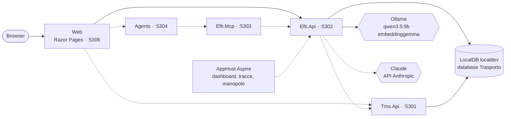

# Trasporto digitale — architettura

> Aggiornato alla **Fase 1 (scaffolding)**. Il documento cresce fase per fase: descrive ciò che il repository contiene oggi e segnala ciò che è previsto ma non ancora scritto.

## 1. Che cos'è

POC dal punto di vista dell'**operatore vettore** del trasporto su strada: uno strato "eFTI-ready" sopra un TMS simulato (Release 1), poi la gestione di eccezioni e reclami (Release 2). Tutti i dati sono sintetici e fittizi.

Stato: la solution si avvia, i servizi sono vuoti, `/api/health` controlla le dipendenze. Modello dati, validazione eFTI, ruoli, tool MCP, agenti ed estrazione dai CMR arrivano con le fasi 2–7.

## 2. Topologia

Le frecce tratteggiate sono riferimenti già dichiarati nell'AppHost ma non ancora usati da codice.

| Servizio | Porta | Ruolo | In Fase 1 |
|---|---|---|---|
| `Tms.Api` | 5301 | TMS simulato, proprietario dello schema `tms` | `/`, `/health` |
| `Efti.Api` | 5302 | Nucleo eFTI, proprietario degli schemi `efti` e `audit` | `/`, `/health`, `/api/health` |
| `Efti.Mcp` | 5303 | Server MCP eFTI | endpoint `/mcp` senza tool |
| `Agents` | 5304 | Agenti, client MCP, nessun accesso al database | `/`, `/health` |
| `Web` | 5306 | UI | pagina di stato |

La porta 5305 è riservata a `Claims.Mcp` (Release 2). O2C usa 5101–5106 e Sinistri 5201–5202: le tre demo possono girare insieme.

Regole di confine, valide da subito:

- ogni schema ha un solo proprietario; Web, server MCP e agenti non leggono il database;
- gli agenti agiscono solo attraverso i tool MCP;
- i provider dei modelli sono noti a un solo progetto, `Ai`: il resto vede `IChatClient` e `IEmbeddingGenerator`.

## 3. Progetti

| Progetto | Contenuto |
|---|---|
| `AppHost` | Risorse, riferimenti fra servizi, manopole |
| `ServiceDefaults` | OpenTelemetry, health check, resilienza HTTP, service discovery |
| `Shared` | Contratti e helper puri: nomi di telemetria, contratti di health, regole JSON |
| `Tms.Data`, `Efti.Data` | `DbContext` EF Core, uno per schema (`tms`; `efti`, `audit`), ancora senza entità |
| `Efti.Core` | Logica deterministica del nucleo (vuoto) |
| `Ai` | Manopole dei modelli, fabbriche dei client, cattura dei prompt, probe di health |
| `Documents.Extraction` | Estrazione dai CMR (vuoto), libreria ospitata da `Efti.Api` |
| `Mcp.Hosting` | Composizione comune dei server MCP |
| `tools/DbInit` | Ricrea il database dal modello, senza migration |
| `tools/Eval` | CLI di valutazione (segnaposto) |

## 4. Modelli

Il modello si sceglie **per compito**. Chi ha bisogno di un modello chiede a `IChatClientFactory.Create(ModelTask)` e riceve il client già avvolto da logging e OpenTelemetry, più le opzioni di default del provider.

| Compito | Provider di default | Manopola |
|---|---|---|
| `Extraction` | `ollama` | `MODEL_EXTRACTION_PROVIDER` |
| `Mapping` | `ollama` | `MODEL_MAPPING_PROVIDER` |
| `Draft` (Release 2) | `anthropic` | `MODEL_DRAFT_PROVIDER` |
| `Judge` (Release 2) | `anthropic` | `MODEL_JUDGE_PROVIDER` |

Regole per provider:

- **Ollama**: temperatura 0,1, thinking spento, finestra di contesto da `OLLAMA_NUM_CTX` (8192), client HTTP dedicato con timeout di 10 minuti.
- **Anthropic**: `ANTHROPIC_MODEL` (`claude-haiku-4-5`) per tutti i compiti tranne il giudice, che usa `ANTHROPIC_JUDGE_MODEL` (`claude-sonnet-5-5`). La temperatura 0,1 si invia solo ai modelli Haiku 4.5; agli altri non si invia alcun parametro di campionamento.
- **Embedding**: sempre Ollama, sulla CPU (`num_gpu = 0`), per non togliere VRAM alla chat.

Con `TRASPORTO_PROMPT_CAPTURE_DIR` ogni richiesta e risposta viene salvata su file per la diagnostica. I file possono contenere dati di business: la cartella va tenuta fuori dal repository.

### Manopole

Si impostano sull'AppHost (user-secrets, riga di comando o variabili d'ambiente) e vengono inoltrate a `Efti.Api` e `Agents`; senza valore vale il default del codice (`AiOptions`).

| Manopola | Default |
|---|---|
| `OLLAMA_ENDPOINT` | `http://127.0.0.1:11434` |
| `OLLAMA_CHAT_MODEL`, `OLLAMA_NUM_CTX` | `qwen3.5:9b`, `8192` |
| `ANTHROPIC_MODEL`, `ANTHROPIC_JUDGE_MODEL` | `claude-haiku-4-5`, `claude-sonnet-5-5` |
| `MODEL_<COMPITO>_PROVIDER` | vedi tabella sopra |
| `EMBEDDING_MODEL`, `EMBEDDING_DIMENSIONS` | `embeddinggemma`, `768` |
| `TRASPORTO_PROMPT_CAPTURE_DIR` | — |

Segreti, solo negli user-secrets dell'AppHost: `ConnectionStrings:sql` e `Parameters:anthropic-api-key`. La chiave è facoltativa all'avvio: senza, i compiti locali funzionano e il controllo 9 lo segnala.

## 5. Controlli di salute

`GET /api/health` su `Efti.Api` restituisce l'esito di ogni controllo. Lo stesso report, con una cache di 30 secondi, alimenta l'health check ASP.NET (`/health`) letto da Aspire: un errore rende `efti-api` non sano nel dashboard, un avviso lo rende degradato.

| # | Controllo | Errore | Avviso |
|---|---|---|---|
| 1 | Connessione SQL | server non raggiungibile, connection string assente | — |
| 2 | Versione SQL Server | major < 17 | — |
| 3 | Supporto `VECTOR` | `VECTOR_DISTANCE` non disponibile | — |
| 4 | Database applicativo | database non indicato | database non ancora creato |
| 5 | Ollama raggiungibile | non risponde | — |
| 6 | Modello di chat presente | non installato | — |
| 7 | Modello di embedding presente | non installato | — |
| 8 | Dimensione dell'embedding | diversa da `EMBEDDING_DIMENSIONS` | — |
| 9 | Chiave Anthropic | assente con estrazione o mappatura instradate sul cloud | assente, nessun compito attivo la richiede |
| 10 | Posizionamento dei modelli | — | embedding in VRAM, chat non tutta in VRAM |

Il controllo 9 guarda solo se la chiave è presente: non chiama l'API.

## 6. Dati

Database `Trasporto` su `(localdb)\localdev` (SQL Server 2025), con gli schemi `tms`, `efti`, `audit` e, nella Release 2, `claims` e `rag`. Il database si ricrea da zero con `tools/Dusiburg.AI.Trasporto.DbInit`: nessuna migration. Oggi i `DbContext` non hanno entità e il database nasce vuoto.

## 7. Test e CI

- `Ai.Tests`: manopole, fabbriche dei client, aggregazione dei controlli. Nessuna chiamata a un modello.
- `Efti.Api.Tests`: endpoint con probe finti; controlli SQL veri su un database usa-e-getta creato da `DbInit`.
- La CI gira su Windows con LocalDB. I test della categoria `RequiresSql2025` si saltano se LocalDB è più vecchio della versione 17 e restano obbligatori in locale.

## 8. Decisioni

Gli identificativi sono quelli del piano di progetto.

| # | Decisione | Alternativa scartata |
|---|---|---|
| G6 | Repository separato da O2C e Sinistri; i loro pattern sono copiati e adattati | Monorepo |
| G9 | LocalDB `localdev`, Ollama nativo, `DbInit` senza migration | Container e migration |
| G10 | EF Core per la parte relazionale, Dapper solo per le query vettoriali | Un solo accesso ai dati |
| G11 | Agent Framework, MCP C# SDK, Claude via API Anthropic, `qwen3.5:9b` ed `embeddinggemma` in locale | Azure OpenAI |
| P1 | Un `DbContext` per schema | Un solo schema |
| P2 | Ingestione dal TMS con pull HTTP, niente broker | RabbitMQ come in O2C |
| P3 | `Documents.Extraction` e `Ai` sono librerie ospitate da `Efti.Api` | Un servizio per componente |
| P4 | Gli agenti stanno in un servizio a parte, client MCP, senza database | Agenti dentro `Efti.Api` |
| P8 | Porte locali 5301–5306 | — |
| D2 | NUnit resta alla 4.6.1 | NUnit 5.0.0, appena uscita |
| D3 | Cloud di default `claude-haiku-4-5`, giudice `claude-sonnet-5-5` | Un solo modello cloud |
| F1.1 | Il modello si chiede alla fabbrica per compito; nessun `IChatClient` registrato nel contenitore | Un client unico, come in O2C: non permette il routing per compito |
| F1.2 | La chiave Anthropic è facoltativa all'avvio dell'AppHost | Parametro obbligatorio: la demo locale non partirebbe senza chiave |
| F1.3 | Nessun correlation id applicativo: l'audit userà il trace id di OpenTelemetry | Correlation id come in O2C |

### Versioni

.NET 10 (SDK 10.0.400, `latestFeature`), Aspire 13.6.0, EF Core 10.0.12, `Microsoft.Extensions.AI` 10.10.0, `Microsoft.Agents.AI` 1.23.0, `ModelContextProtocol` 2.2.0, `Anthropic` 12.53.0, `OllamaSharp` 5.5.0, OpenTelemetry 1.19.1 (pacchetti di strumentazione 1.19.0), NUnit 4.6.1.
